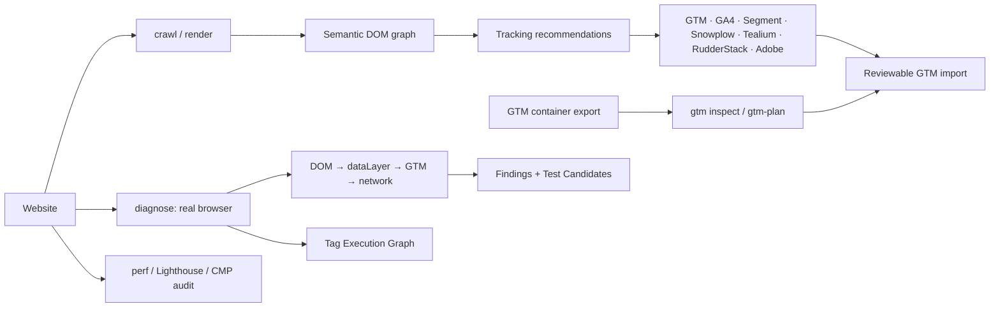

# PyTagManager

**Find out why a tag didn't fire — and what to fix — without stepping through GTM Preview one interaction at a time.**

PyTagManager is an open-source debugging and implementation-intelligence toolkit for Google Tag Manager. It reads your GTM container, drives the real site in a real browser, and correlates the full chain:

```
interaction → DOM mutation → dataLayer → GTM → analytics request → destination
```

When something breaks, you get a specific finding with evidence, a confidence level, and a remediation hint — not a raw event log to interpret by hand.

[](https://github.com/Mullassery/PyTagManager/actions/workflows/ci.yml)
[](https://pypi.org/project/pytagmanager/)
[](https://pypi.org/project/pytagmanager/)
[](LICENSE)
[](https://pypi.org/project/pytagmanager/)

> **Status:** v0.6.0, actively developed and solo-maintained. The PyPI wheel is macOS arm64 only; other platforms build from source and need a Rust toolchain. The published test suite is 23 Rust tests + 694 Python tests, including real headless-Chromium runs. See [Limitations](#limitations) before relying on it in production.

## Why this exists

GTM Preview tells you what fired. It does not tell you:

- which tags **should** have fired but didn't;
- which trigger condition or variable reference is the reason;
- whether the same business action fires the **same event shape** on every template;
- whether a tag is duplicated, blocked by consent, or lost between dataLayer and the network;
- how much a script actually costs when you block it and re-measure.

Engineers answer those questions today by hand-inspecting pages, clicking through Preview one journey at a time, and discovering regressions after reports look wrong. PyTagManager automates that loop and keeps the evidence attached.

**It is not a GTM replacement, a CDP, or an attribution/measurement platform.** GTM remains the tag manager. PyTagManager observes, explains, and proposes reviewable changes; it never activates anything in production on its own.

## Install

Requires Python 3.10+.

```bash
pip install pytagmanager

# Browser diagnostics, dictionary, perf, and CMP audit extras:
pip install 'pytagmanager[diagnostics]'
playwright install chromium
```

The published wheel is macOS arm64. Linux/Windows currently install from the sdist and need a Rust toolchain. Full setup notes: [`docs/GETTING_STARTED.md`](docs/GETTING_STARTED.md).

## 60-second tour

No GTM credentials required for any of these.

```bash
# 1. Explain likely faults in an exported GTM container.
pytagmanager gtm inspect gtm-container.json

# 2. Crawl a site, build a semantic DOM graph, and recommend tracking.
pytagmanager crawl https://example.com --max-pages 20

# 3. Drive a real browser and diagnose the runtime chain.
pytagmanager diagnose https://example.com --max-pages 10
```

### Go deeper

```bash
# Does the event survive from dataLayer to the network?
pytagmanager diagnose https://example.com --trace --format json

# Is the same business action implemented consistently site-wide?
pytagmanager diagnose https://example.com --site-wide --max-pages 100

# What variables exist, what type are they, and what changed since last week?
pytagmanager dictionary https://example.com --compare-to baseline.json

# What would change in the live container before I publish anything?
pytagmanager gtm-plan --generated gtm.json --container GTM-XXXXXXX --credentials sa.json
```

## Use cases

- **A tag stopped firing after a release.** Run `diagnose --site-wide --history health.json` and compare the failing template against the previous run.
- **You are migrating or auditing GTM.** Inspect the export with `gtm inspect`, crawl the site with `crawl --export gtm`, and review the delta with `gtm-plan` before touching production.
- **You need to prove consent actually blocks tracking.** Use `cmp audit` to capture pre/post-choice requests and reload persistence without making a compliance claim.
- **A vendor script looks expensive.** Use `perf --isolate` to block it plus its downstream dependencies and re-measure the same page.
- **A tracking bug needs a regression test.** Turn findings into `--test-candidates`, review them, then formalize the useful ones as Playwright tests.

## What it does

| Area | Commands | Question it answers |
|---|---|---|
| **GTM config review** | `gtm inspect`, `gtm-plan`, `gtm import/export` | Which tag, trigger, or variable is misconfigured — before runtime? |
| **Runtime diagnosis** | `diagnose`, `--scenario`, `--site-wide`, `--history` | What fired, what should have fired, where did they diverge, and why? |
| **Data dictionary** | `dictionary` | Which dataLayer fields, cookies, and storage keys exist, where, and how did they drift? |
| **Tag execution** | `scan-tags`, `--tag-graph`, `--detect-duplicate-tags`, `--detect-server-side-tagging` | Which vendors are present, what is duplicated, and what is inferred vs. observed? |
| **Performance** | `perf`, `lighthouse`, `lighthouse-ci` | What do LCP/TBT/INP look like, and what happens when one script is blocked? |
| **Consent** | `cmp audit` | What does the CMP expose, what fired before/after choice, and does it persist? |
| **Implementation** | `crawl --export`, `diff`, `--render` | What should be tagged, and what changed between crawls? |
| **Operations** | `container`, `config`, `environment`, `cdn`, `serve-ingest` | How is tag configuration versioned, reviewed, published, and collected? |

### GTM container analysis

`gtm inspect` works on an exported JSON/YAML container and reports deterministic findings such as tags with no firing trigger, dangling trigger references, duplicate names, undefined `{{variable}}` references, GA4 event tags missing an event name, duplicate delivery on the same trigger set, and unused or paused tags.

`gtm-plan` compares a generated container against the **live** container and reports what would be added, already exists, or conflicts. It is read-only. `gtm import` creates a draft revision and never activates it; unsupported trigger conditions and variable types are reported instead of silently reinterpreted.

### Runtime diagnosis

`diagnose` injects an observer before page scripts run, captures clicks/submits/changes, SPA navigation, JS errors, consent state, `fetch`/XHR calls, and runtime storage/dataLayer snapshots. It then groups the stream into one journey per interaction and runs deterministic rules for:

- missing or misnamed dataLayer events;
- tags that did not execute;
- missing or unconfirmed GA4 requests;
- duplicate events;
- consent-blocked tracking;
- JS errors immediately preceding a missing event;
- SPA navigation without a page view;
- parameter loss between dataLayer and the network request;
- missing ecommerce parameters;
- content-pattern PII leaks.

Every finding carries **severity** (how bad) and **confidence** (how sure the rule is why): `Confirmed`, `Highly likely`, `Possible`, or `Needs investigation`. A JS-error correlation is never presented with the same certainty as a directly observed missing event.

`--site-wide` clusters pages into templates, surfaces cross-page regressions like “51 of 342 product pages never send `add_to_cart`”, flags statistical outliers, checks the same business action across implementations, and builds a runtime event map. `--history` plus `--alert-webhook` turns repeated runs into a regression signal for cron/CI.

### Tag Execution Graph and Test Candidates

`scan-tags` detects GTM containers and 24 curated vendor signatures (GA4, Google Ads, Floodlight, Meta Pixel, Adobe, Segment, Mixpanel, Hotjar, Optimizely, and others), including late-injected scripts caught by a second DOM snapshot.

`--tag-graph` joins static scan nodes, interaction traces, duplicate findings, and server-side indicators into one graph. Every edge is labeled with an evidence level (`Observed`, `Inferred`, `Suspected`, `Unknown`, or `Not observed`) — never stronger than the underlying evidence. The graph can be exported as a standalone interactive HTML/SVG file.

`--test-candidates` turns findings into reviewed-before-use Playwright candidates. Severity is structurally capped at “Requires verification”; generated drafts end in `raise NotImplementedError` so they cannot be mistaken for passing tests.

### Performance with controlled experiments

`perf` measures real browser-native LCP, CLS, FCP, TBT, and INP over repeated runs (median, not a single sample), builds a script inventory with initiator and dependency data, and supports real CDP CPU throttling.

The differentiator is isolation: block one script — or a class such as `ads`/`analytics`/`tag_management` — plus everything downstream of it, and re-measure. Results are reported as **observed impact for that experiment**, never as a universal claim about a script's cost.

`lighthouse-ci` runs independent audits, keeps failures instead of dropping them, reports medians/ranges, and only fails against explicit budgets you provide.

### Consent evidence, not compliance scores

`cmp audit` detects CMP signatures, reads consent state, records pre/post-choice analytics and advertising requests, and checks reload persistence. It normalizes documented TCF v2 and GPP signals without serializing raw TC/GPP strings, and supports data-only custom adapters.

It is read-only by default. It never treats a banner as proof of enforcement, never produces a compliance verdict, and only clicks a consent choice when you pass both `--consent-action` and `--authorize-consent-interaction` in an environment you control.

## Evidence, not confident guesses

This project has an explicit documentation-honesty policy:

- **Confidence is part of the output.** Findings distinguish directly observed facts from correlations, inferences, and possibilities.
- **Server-side tagging is hedged by construction.** A browser can only infer relaying from request shape; indicators are always `Likely` or `Possible`, never `Confirmed`.
- **No fabricated metrics.** Missing Lighthouse/Chrome binaries raise an error instead of inventing scores. Per-script CPU time and long-task attribution are disclosed as not measured rather than estimated.
- **Writes are reviewable.** GTM import creates drafts, `gtm-plan` is read-only, and publishing still requires explicit human action.
- **Local-first.** Telemetry does not leave your machine. Optional LLM classification runs against a local Ollama model and falls back to deterministic heuristics when it is unavailable.

See [`ROADMAP_HONEST.md`](ROADMAP_HONEST.md) for exactly what is built and reachable, built but not reachable, not built, and red in CI.

## How it fits together



- **Rust core** (`src/`, PyO3 + maturin): MudFish-powered async crawl (priority frontier, sitemap, robots, retry/backoff, per-host circuit breaker, SSRF guard) plus a semantic DOM graph with stable selector generation.
- **Python layer** (`python/pytagmanager/`): orchestration, recommendations, exporters, GTM analysis, browser observation, correlation, diagnostics, site-wide aggregation, data dictionary, tag execution, performance experiments, CMP audit, reporting, and the CLI.
- **Control plane:** immutable configuration revisions, containers, environments, CDN publication, and a collection endpoint that validates and deduplicates events without owning destination routing (PyTagShield or another adapter handles policy).

## Who it is for

- **Analytics/marketing engineers** who own GTM and get blamed when events disappear.
- **QA and release teams** who need repeatable tracking checks instead of manual Preview sessions.
- **Agencies and consultants** auditing a site before a measurement migration or consent change.

## Limitations

- **Platform coverage:** macOS arm64 wheel only; Linux/Windows build from source. A manylinux wheel needs a proper cross-compile CI toolchain.
- **GTM writes are not automated.** Draft import/export and plan/diff are implemented; publishing still requires manual review in GTM.
- **Server-side detection is inference.** Browser-visible request shape cannot prove server-side relaying.
- **Performance results are experimental.** They describe the controlled run, not every visitor or field data.
- **Mobile SDKs are built but lightly verified.** Web passes 11 Node tests; iOS builds with 19 executable checks (XCTest pending); Android builds with 28 JUnit tests (no device tests).
- **No compliance certification.** CMP findings are evidence, not a legal opinion.

## Development

```bash
cargo test                # Rust: selectors, robots, sitemap, DOM parsing, crawl integration
pytest tests/python -v    # Python: heuristics, exporters, diffing, diagnostics, CMP, perf
```

Browser tests require the diagnostics extra and a Chromium install. Contributor workflow and the documentation-honesty policy are in [`CONTRIBUTING.md`](CONTRIBUTING.md); vulnerability reporting and disclosed risk areas are in [`SECURITY.md`](SECURITY.md).

Architecture, design decisions, and the road not taken:

- [`docs/GETTING_STARTED.md`](docs/GETTING_STARTED.md)
- [`docs/ARCHITECTURE.md`](docs/ARCHITECTURE.md)
- [`docs/VISION.md`](docs/VISION.md)
- [`docs/ROADMAP.md`](docs/ROADMAP.md)
- [`docs/CMP_AUDIT.md`](docs/CMP_AUDIT.md)
- [`CHANGELOG.md`](CHANGELOG.md)

## Related projects

Part of the Mullassery open-source family — PyTagManager sits at the tagging/implementation end of the customer-data stack:

- [PyTagShield](https://github.com/Mullassery/PyTagShield) — consent-aware, privacy-minimizing server-side event pipeline; can consume PyTagManager's managed revisions as startup config
- [ClusterAudienceKit](https://github.com/Mullassery/ClusterAudienceKit) — customer segmentation and audience intelligence
- [PyReverseETL](https://github.com/Mullassery/PyReverseETL) — quality-validated reverse ETL / data activation
- [MessageBirds](https://github.com/Mullassery/MessageBirds) — event-driven customer data and engagement platform
- [StatGuardian](https://github.com/Mullassery/StatGuardian) — runtime data-quality validation
- [PyDeepMesh](https://github.com/Mullassery/PyDeepMesh) — dependency-graph and vulnerability intelligence
- [Browse all projects](https://github.com/Mullassery?tab=repositories)

## License

Apache-2.0. See [`LICENSE`](LICENSE).

---

If PyTagManager saves you a Preview session, a star helps other analytics engineers find it.
