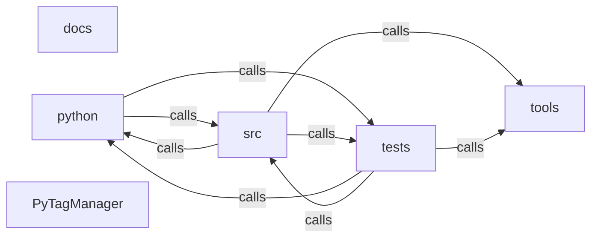

_Generated by CodeAtlas._

## Details

Architecture map of PyTagManager.

### docs

Owns 0 symbols across 3 file(s).

**Related Classes/Methods:** _None_

### python

Owns 0 symbols across 0 file(s).

**Related Classes/Methods:** _None_

### src

Owns 7 symbols across 2 file(s).

**Related Classes/Methods:** _None_

**Source Files:**

- `src/error.rs`
  - `src.error.AppError`
  - `src.error.AppError.fmt`
  - `src.error.AppError.from`
  - `src.error.PyErr.from`
- `src/lib.rs`
  - `src.lib._core`
  - `src.lib.crawl`
  - `src.lib.parse_html`

### tests

Owns 22 symbols across 2 file(s).

**Related Classes/Methods:** _None_

**Source Files:**

- `tests/crawl_integration.rs`
  - `tests.crawl_integration.a_dead_link_does_not_abort_the_rest_of_the_crawl`
  - `tests.crawl_integration.bfs_crawls_all_linked_same_domain_pages_and_skips_off_domain_links`
  - `tests.crawl_integration.bfs_handles_fan_out_across_multiple_concurrency_batches`
  - `tests.crawl_integration.browser_mode_auto_renders_a_js_shell_and_captures_its_network_activity`
  - `tests.crawl_integration.config`
  - `tests.crawl_integration.custom_headers_are_sent_with_every_request`
  - `tests.crawl_integration.fetch_retries_a_503_and_returns_the_eventual_success`
  - `tests.crawl_integration.follows_redirects_and_records_the_final_url_and_status`
  - `tests.crawl_integration.max_pages_1_still_fetches_the_seed_page`
  - `tests.crawl_integration.max_pages_caps_exactly_when_more_pages_are_reachable`
  - `tests.crawl_integration.max_pages_caps_total_pages_discovered_and_the_crawl_terminates`
  - `tests.crawl_integration.non_2xx_status_pages_are_recorded_rather_than_dropped`
  - `tests.crawl_integration.respects_robots_txt_disallow_for_wildcard_agent`
  - `tests.crawl_integration.robots_txt_disallow_is_ignored_when_respect_robots_is_false`
  - `tests.crawl_integration.sitemap_xml_seeds_a_page_with_no_inbound_links`
  - `tests.crawl_integration.ssrf_guard_blocks_start_url_when_private_networks_are_not_allowed`
  - `tests.crawl_integration.urls`
- `tests/test_codeatlas_adapter.py`
  - `tests.test_codeatlas_adapter._run`
  - `tests.test_codeatlas_adapter.test_check_reports_the_embedded_engine_available`
  - `tests.test_codeatlas_adapter.test_diagnose_summarises_the_architecture_map`
  - `tests.test_codeatlas_adapter.test_explain_reports_an_unknown_node_as_an_error`
  - `tests.test_codeatlas_adapter.test_god_nodes_are_ranked_by_degree`

### tools

Owns 0 symbols across 0 file(s).

**Related Classes/Methods:** _None_

### PyTagManager

Owns 0 symbols across 11 file(s).

**Related Classes/Methods:** _None_
