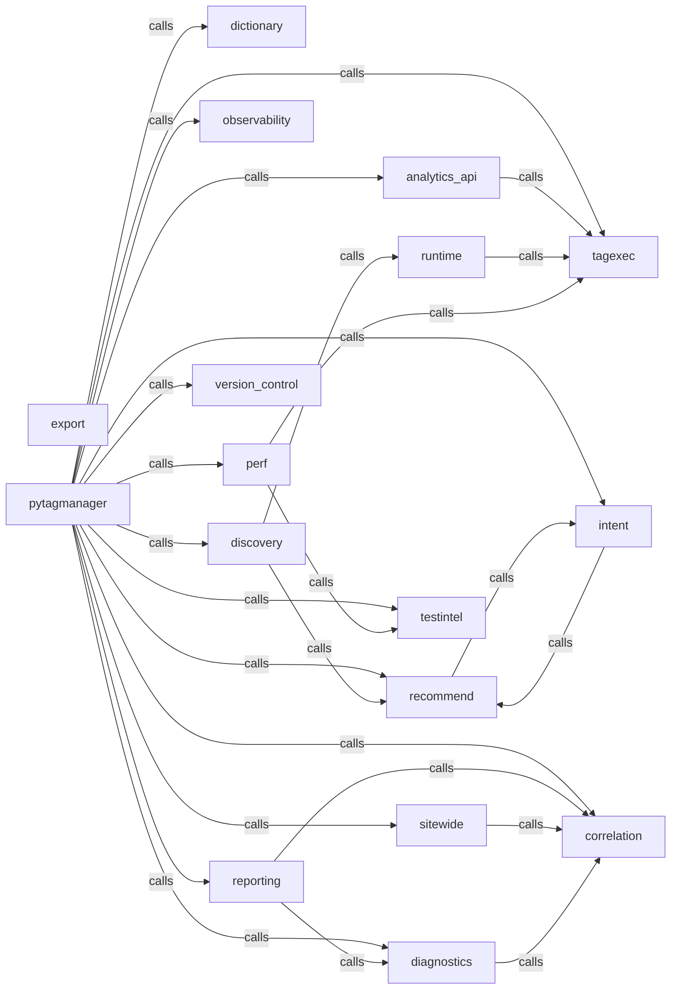

_Generated by CodeAtlas._

## Details

Owns 8 symbols across 2 file(s).

### analytics_api

Owns 19 symbols across 4 file(s).

**Related Classes/Methods:** _None_

**Source Files:**

- `python/pytagmanager/analytics_api/ga4_client.py`
  - `python.pytagmanager.analytics_api.ga4_client.Ga4ApiClient`
  - `python.pytagmanager.analytics_api.ga4_client.Ga4ApiClient.__init__`
  - `python.pytagmanager.analytics_api.ga4_client.Ga4ApiClient.from_service_account`
  - `python.pytagmanager.analytics_api.ga4_client.Ga4ApiClient.list_conversion_events`
  - `python.pytagmanager.analytics_api.ga4_client.Ga4ApiClient.list_custom_dimensions`
  - `python.pytagmanager.analytics_api.ga4_client.Ga4ApiClient.was_event_ingested_realtime`
- `python/pytagmanager/analytics_api/gtm_client.py`
  - `python.pytagmanager.analytics_api.gtm_client.GtmApiClient`
  - `python.pytagmanager.analytics_api.gtm_client.GtmApiClient.__init__`
  - `python.pytagmanager.analytics_api.gtm_client.GtmApiClient.find_container_by_public_id`
  - `python.pytagmanager.analytics_api.gtm_client.GtmApiClient.from_oauth_user`
  - `python.pytagmanager.analytics_api.gtm_client.GtmApiClient.from_service_account`
  - `python.pytagmanager.analytics_api.gtm_client.GtmApiClient.get_live_container_config`
  - `python.pytagmanager.analytics_api.gtm_client._extract_custom_event_name`
  - `python.pytagmanager.analytics_api.gtm_client._normalize_tag`
  - `python.pytagmanager.analytics_api.gtm_client._normalize_trigger`
- `python/pytagmanager/analytics_api/models.py`
  - `python.pytagmanager.analytics_api.models.Ga4CustomDimension`
  - `python.pytagmanager.analytics_api.models.Ga4EventDefinition`
  - `python.pytagmanager.analytics_api.models.GtmTag`
  - `python.pytagmanager.analytics_api.models.GtmTrigger`

### correlation

Owns 9 symbols across 2 file(s).

**Related Classes/Methods:** _None_

**Source Files:**

- `python/pytagmanager/correlation/journey.py`
  - `python.pytagmanager.correlation.journey.TrackingJourney`
  - `python.pytagmanager.correlation.journey.TrackingJourney.anchor_selector`
  - `python.pytagmanager.correlation.journey.TrackingJourney.events_of_type`
  - `python.pytagmanager.correlation.journey.TrackingJourney.stage_present`
  - `python.pytagmanager.correlation.journey.TrackingJourney.stages`
  - `python.pytagmanager.correlation.journey.TrackingJourney.with_diagnosis`
  - `python.pytagmanager.correlation.journey._infer_business_event`
  - `python.pytagmanager.correlation.journey.correlate_events`
  - `python.pytagmanager.correlation.journey.stage_for_event_type`

### diagnostics

Owns 41 symbols across 4 file(s).

**Related Classes/Methods:** _None_

**Source Files:**

- `python/pytagmanager/diagnostics/models.py`
  - `python.pytagmanager.diagnostics.models.Diagnosis`
  - `python.pytagmanager.diagnostics.models.Diagnosis.healthy`
- `python/pytagmanager/diagnostics/rules.py`
  - `python.pytagmanager.diagnostics.rules.DiagnosticContext`
  - `python.pytagmanager.diagnostics.rules.DiagnosticContext.__post_init__`
  - `python.pytagmanager.diagnostics.rules.DiagnosticContext.expected_datalayer_event`
  - `python.pytagmanager.diagnostics.rules.DiagnosticContext.expects_any_datalayer_event`
  - `python.pytagmanager.diagnostics.rules.DiagnosticContext.ga4_ingested`
  - `python.pytagmanager.diagnostics.rules.DiagnosticContext.state_diff_for_journey`
  - `python.pytagmanager.diagnostics.rules._consent_denied`
  - `python.pytagmanager.diagnostics.rules._find_closest_trigger`
  - `python.pytagmanager.diagnostics.rules._find_trigger_by_event`
  - `python.pytagmanager.diagnostics.rules._first_event_name`
  - `python.pytagmanager.diagnostics.rules._flatten_values`
  - `python.pytagmanager.diagnostics.rules._normalize`
  - `python.pytagmanager.diagnostics.rules._normalize_selector`
  - `python.pytagmanager.diagnostics.rules.diagnose_journey`
  - `python.pytagmanager.diagnostics.rules.find_duplicate_purchases`
  - `python.pytagmanager.diagnostics.rules.find_untested_recommendations`
  - `python.pytagmanager.diagnostics.rules.primary_diagnosis`
  - `python.pytagmanager.diagnostics.rules.rule_api_call_without_tracking_event`
  - `python.pytagmanager.diagnostics.rules.rule_consent_blocking`
  - `python.pytagmanager.diagnostics.rules.rule_duplicate_analytics_request`
  - `python.pytagmanager.diagnostics.rules.rule_duplicate_datalayer_event`
  - `python.pytagmanager.diagnostics.rules.rule_ecommerce_missing_parameters`
  - `python.pytagmanager.diagnostics.rules.rule_event_name_mismatch`
  - `python.pytagmanager.diagnostics.rules.rule_gtm_tag_not_executed`
  - `python.pytagmanager.diagnostics.rules.rule_js_error_blocking`
  - `python.pytagmanager.diagnostics.rules.rule_missing_analytics_request`
  - `python.pytagmanager.diagnostics.rules.rule_missing_datalayer_event`
  - `python.pytagmanager.diagnostics.rules.rule_parameter_loss`
  - `python.pytagmanager.diagnostics.rules.rule_pii_leak`
  - `python.pytagmanager.diagnostics.rules.rule_spa_navigation_missing_pageview`
  - `python.pytagmanager.diagnostics.rules.rule_timing_delay`
- `python/pytagmanager/diagnostics/trace.py`
  - `python.pytagmanager.diagnostics.trace.InteractionTrace`
  - `python.pytagmanager.diagnostics.trace.InteractionTraceStep`
  - `python.pytagmanager.diagnostics.trace.StorageChange`
  - `python.pytagmanager.diagnostics.trace._storage_changes`
  - `python.pytagmanager.diagnostics.trace.build_interaction_trace`
  - `python.pytagmanager.diagnostics.trace.build_interaction_trace_json`
  - `python.pytagmanager.diagnostics.trace.build_interaction_traces`
  - `python.pytagmanager.diagnostics.trace.render_interaction_trace`

### dictionary

Owns 44 symbols across 6 file(s).

**Related Classes/Methods:** _None_

**Source Files:**

- `python/pytagmanager/dictionary/build.py`
  - `python.pytagmanager.dictionary.build.DataDictionary`
  - `python.pytagmanager.dictionary.build.DataDictionary.by_source`
  - `python.pytagmanager.dictionary.build.DictionaryVariable`
  - `python.pytagmanager.dictionary.build.DictionaryVariable.observed_count`
  - `python.pytagmanager.dictionary.build.DictionaryVariable.presence_ratio`
  - `python.pytagmanager.dictionary.build.DictionaryVariable.value_type_distribution`
  - `python.pytagmanager.dictionary.build._Accumulator`
  - `python.pytagmanager.dictionary.build._Accumulator.__init__`
  - `python.pytagmanager.dictionary.build._Accumulator.record`
  - `python.pytagmanager.dictionary.build._flatten_datalayer_fields`
  - `python.pytagmanager.dictionary.build._value_type`
  - `python.pytagmanager.dictionary.build.build_data_dictionary`
  - `python.pytagmanager.dictionary.build.data_dictionary_from_json`
- `python/pytagmanager/dictionary/labels.py`
  - `python.pytagmanager.dictionary.labels.PresenceLabel`
  - `python.pytagmanager.dictionary.labels.label_presence`
- `python/pytagmanager/dictionary/purpose.py`
  - `python.pytagmanager.dictionary.purpose.HeuristicPurposeClassifier`
  - `python.pytagmanager.dictionary.purpose.HeuristicPurposeClassifier.classify`
  - `python.pytagmanager.dictionary.purpose.OllamaPurposeClassifier`
  - `python.pytagmanager.dictionary.purpose.OllamaPurposeClassifier.__init__`
  - `python.pytagmanager.dictionary.purpose.OllamaPurposeClassifier._build_prompt`
  - `python.pytagmanager.dictionary.purpose.OllamaPurposeClassifier._classify_via_ollama`
  - `python.pytagmanager.dictionary.purpose.OllamaPurposeClassifier.classify`
  - `python.pytagmanager.dictionary.purpose.OllamaPurposeClassifier.is_available`
  - `python.pytagmanager.dictionary.purpose.PurposeClassifier`
  - `python.pytagmanager.dictionary.purpose.PurposeClassifier.classify`
  - `python.pytagmanager.dictionary.purpose.PurposeResult`
  - `python.pytagmanager.dictionary.purpose._campaign_url_evidence`
  - `python.pytagmanager.dictionary.purpose._persistence_evidence`
- `python/pytagmanager/dictionary/report.py`
  - `python.pytagmanager.dictionary.report._variable_key`
  - `python.pytagmanager.dictionary.report.build_dictionary_json`
  - `python.pytagmanager.dictionary.report.render_dictionary_report`
- `python/pytagmanager/dictionary/schema_drift.py`
  - `python.pytagmanager.dictionary.schema_drift.DictionaryDrift`
  - `python.pytagmanager.dictionary.schema_drift.DictionaryDrift.has_changes`
  - `python.pytagmanager.dictionary.schema_drift.PossibleRename`
  - `python.pytagmanager.dictionary.schema_drift.PossibleRename.render`
  - `python.pytagmanager.dictionary.schema_drift.TypeDistributionShift`
  - `python.pytagmanager.dictionary.schema_drift.TypeDistributionShift.render`
  - `python.pytagmanager.dictionary.schema_drift._event_prefix`
  - `python.pytagmanager.dictionary.schema_drift._leaf_name`
  - `python.pytagmanager.dictionary.schema_drift._possible_renames`
  - `python.pytagmanager.dictionary.schema_drift._type_shift`
  - `python.pytagmanager.dictionary.schema_drift.build_drift_json`
  - `python.pytagmanager.dictionary.schema_drift.diff_dictionaries`
  - `python.pytagmanager.dictionary.schema_drift.render_drift_report`

### discovery

Owns 4 symbols across 2 file(s).

**Related Classes/Methods:** _None_

**Source Files:**

- `python/pytagmanager/discovery/crawl.py`
  - `python.pytagmanager.discovery.crawl.RenderedPage`
  - `python.pytagmanager.discovery.crawl._top_selectors`
  - `python.pytagmanager.discovery.crawl.crawl_site`
  - `python.pytagmanager.discovery.crawl.crawl_site_rendered`

### export

Owns 21 symbols across 10 file(s).

**Related Classes/Methods:** _None_

**Source Files:**

- `python/pytagmanager/export/_taxonomy.py`
  - `python.pytagmanager.export._taxonomy.canonical_event`
- `python/pytagmanager/export/adobe_tags.py`
  - `python.pytagmanager.export.adobe_tags._rule_name`
  - `python.pytagmanager.export.adobe_tags.build_adobe_launch_rules`
  - `python.pytagmanager.export.adobe_tags.export_adobe_tags_json`
- `python/pytagmanager/export/base.py`
  - `python.pytagmanager.export.base.Exporter`
  - `python.pytagmanager.export.base.Exporter.export`
  - `python.pytagmanager.export.base.ExporterSpec`
- `python/pytagmanager/export/ga4.py`
  - `python.pytagmanager.export.ga4.build_ga4_config`
  - `python.pytagmanager.export.ga4.export_ga4_json`
- `python/pytagmanager/export/gtm.py`
  - `python.pytagmanager.export.gtm.build_gtm_container`
  - `python.pytagmanager.export.gtm.export_gtm_json`
- `python/pytagmanager/export/rudderstack.py`
  - `python.pytagmanager.export.rudderstack.build_rudderstack_tracking_plan`
  - `python.pytagmanager.export.rudderstack.export_rudderstack_json`
- `python/pytagmanager/export/segment.py`
  - `python.pytagmanager.export.segment.build_segment_tracking_plan`
  - `python.pytagmanager.export.segment.export_segment_json`
- `python/pytagmanager/export/snowplow.py`
  - `python.pytagmanager.export.snowplow._schema_uri`
  - `python.pytagmanager.export.snowplow._self_describing_schema`
  - `python.pytagmanager.export.snowplow.build_snowplow_schemas`
  - `python.pytagmanager.export.snowplow.export_snowplow_json`
- `python/pytagmanager/export/tealium.py`
  - `python.pytagmanager.export.tealium.build_tealium_profile`
  - `python.pytagmanager.export.tealium.export_tealium_json`

### intent

Owns 14 symbols across 3 file(s).

**Related Classes/Methods:** _None_

**Source Files:**

- `python/pytagmanager/intent/base.py`
  - `python.pytagmanager.intent.base.ClaudeIntentClassifier`
  - `python.pytagmanager.intent.base.ClaudeIntentClassifier.__init__`
  - `python.pytagmanager.intent.base.ClaudeIntentClassifier.classify`
  - `python.pytagmanager.intent.base.IntentClassifier`
  - `python.pytagmanager.intent.base.IntentClassifier.classify`
  - `python.pytagmanager.intent.base.IntentResult`
  - `python.pytagmanager.intent.base.PageContext`
- `python/pytagmanager/intent/ollama_classifier.py`
  - `python.pytagmanager.intent.ollama_classifier.OllamaIntentClassifier`
  - `python.pytagmanager.intent.ollama_classifier.OllamaIntentClassifier.__init__`
  - `python.pytagmanager.intent.ollama_classifier.OllamaIntentClassifier._build_prompt`
  - `python.pytagmanager.intent.ollama_classifier.OllamaIntentClassifier._classify_via_ollama`
  - `python.pytagmanager.intent.ollama_classifier.OllamaIntentClassifier._fallback`
  - `python.pytagmanager.intent.ollama_classifier.OllamaIntentClassifier.classify`
  - `python.pytagmanager.intent.ollama_classifier.OllamaIntentClassifier.is_available`

### observability

Owns 60 symbols across 6 file(s).

**Related Classes/Methods:** _None_

**Source Files:**

- `python/pytagmanager/observability/agent.js`
  - `python.pytagmanager.observability.agent.captureDataLayerSnapshot`
  - `python.pytagmanager.observability.agent.captureStorage`
  - `python.pytagmanager.observability.agent.classifyStorageValue`
  - `python.pytagmanager.observability.agent.cssPath`
  - `python.pytagmanager.observability.agent.currentScrollDepthPercent`
  - `python.pytagmanager.observability.agent.describeSelector`
  - `python.pytagmanager.observability.agent.flushMutations`
  - `python.pytagmanager.observability.agent.isAnalyticsUrl`
  - `python.pytagmanager.observability.agent.isInteresting`
  - `python.pytagmanager.observability.agent.mutationKey`
  - `python.pytagmanager.observability.agent.normalizeDataLayerItem`
  - `python.pytagmanager.observability.agent.onRouteChange`
  - `python.pytagmanager.observability.agent.queueMutation`
  - `python.pytagmanager.observability.agent.safeEmit`
  - `python.pytagmanager.observability.agent.wrapDataLayer`
  - `python.pytagmanager.observability.agent.wrapHistoryMethod`
- `python/pytagmanager/observability/events.py`
  - `python.pytagmanager.observability.events.TrackingEvent`
  - `python.pytagmanager.observability.events.TrackingEvent.create`
  - `python.pytagmanager.observability.events.TrackingEvent.from_dict`
  - `python.pytagmanager.observability.events.is_sensitive_key`
  - `python.pytagmanager.observability.events.redact_payload`
- `python/pytagmanager/observability/scenario.py`
  - `python.pytagmanager.observability.scenario.ActionStep`
  - `python.pytagmanager.observability.scenario.Expectation`
  - `python.pytagmanager.observability.scenario.Scenario`
  - `python.pytagmanager.observability.scenario.Scenario.from_dict`
  - `python.pytagmanager.observability.scenario.auto_scenario_from_recommendations`
  - `python.pytagmanager.observability.scenario.load_scenario`
  - `python.pytagmanager.observability.scenario.load_scenarios_dir`
- `python/pytagmanager/observability/session.py`
  - `python.pytagmanager.observability.session.ObservationSession`
  - `python.pytagmanager.observability.session.ObservationSession.__enter__`
  - `python.pytagmanager.observability.session.ObservationSession.__exit__`
  - `python.pytagmanager.observability.session.ObservationSession.__init__`
  - `python.pytagmanager.observability.session.ObservationSession._on_agent_event`
  - `python.pytagmanager.observability.session.ObservationSession._on_network_request`
  - `python.pytagmanager.observability.session.ObservationSession._run_step`
  - `python.pytagmanager.observability.session.ObservationSession.add_route`
  - `python.pytagmanager.observability.session.ObservationSession.capture_html`
  - `python.pytagmanager.observability.session.ObservationSession.capture_state`
  - `python.pytagmanager.observability.session.ObservationSession.events`
  - `python.pytagmanager.observability.session.ObservationSession.load`
  - `python.pytagmanager.observability.session.ObservationSession.run_scenario`
  - `python.pytagmanager.observability.session.ObservationSession.scroll_into_view`
  - `python.pytagmanager.observability.session.ObservationSession.state_diffs`
  - `python.pytagmanager.observability.session.ObservationSession.state_snapshots`
  - `python.pytagmanager.observability.session.ObservationSession.wait`
  - `python.pytagmanager.observability.session._classify_network_url`
  - `python.pytagmanager.observability.session._parse_query_params`
- `python/pytagmanager/observability/state.py`
  - `python.pytagmanager.observability.state.RuntimeStateSnapshot`
  - `python.pytagmanager.observability.state.RuntimeStateSnapshot.from_raw`
  - `python.pytagmanager.observability.state.StateDiff`
  - `python.pytagmanager.observability.state.StateDiff.is_empty`
  - `python.pytagmanager.observability.state.StorageEntry`
  - `python.pytagmanager.observability.state._classify_raw_value`
  - `python.pytagmanager.observability.state._diff_entries`
  - `python.pytagmanager.observability.state._entries_from_cookie_list`
  - `python.pytagmanager.observability.state._entries_from_js`
  - `python.pytagmanager.observability.state._new_data_layer_event_names`
  - `python.pytagmanager.observability.state._new_data_layer_event_names._fingerprint`
  - `python.pytagmanager.observability.state._redact_value_if_sensitive`
  - `python.pytagmanager.observability.state.diff_state_snapshots`

### perf

Owns 68 symbols across 10 file(s).

**Related Classes/Methods:** _None_

**Source Files:**

- `python/pytagmanager/perf/dependency_graph.py`
  - `python.pytagmanager.perf.dependency_graph.DependencyEdge`
  - `python.pytagmanager.perf.dependency_graph.ScriptDependencyGraph`
  - `python.pytagmanager.perf.dependency_graph.ScriptDependencyGraph.children_of`
  - `python.pytagmanager.perf.dependency_graph.ScriptDependencyGraph.downstream_of`
  - `python.pytagmanager.perf.dependency_graph.build_dependency_graph`
- `python/pytagmanager/perf/experiments.py`
  - `python.pytagmanager.perf.experiments.IsolationExperimentResult`
  - `python.pytagmanager.perf.experiments.IsolationExperimentResult._delta`
  - `python.pytagmanager.perf.experiments.IsolationExperimentResult.cls_delta`
  - `python.pytagmanager.perf.experiments.IsolationExperimentResult.inp_delta_ms`
  - `python.pytagmanager.perf.experiments.IsolationExperimentResult.lcp_delta_ms`
  - `python.pytagmanager.perf.experiments.IsolationExperimentResult.message`
  - `python.pytagmanager.perf.experiments.IsolationExperimentResult.request_count_delta`
  - `python.pytagmanager.perf.experiments.IsolationExperimentResult.tbt_delta_ms`
  - `python.pytagmanager.perf.experiments.IsolationExperimentResult.transfer_bytes_delta`
  - `python.pytagmanager.perf.experiments._closure`
  - `python.pytagmanager.perf.experiments._run`
  - `python.pytagmanager.perf.experiments._script_group`
  - `python.pytagmanager.perf.experiments.available_groups`
  - `python.pytagmanager.perf.experiments.isolate_all_non_essential`
  - `python.pytagmanager.perf.experiments.isolate_group`
  - `python.pytagmanager.perf.experiments.isolate_script`
- `python/pytagmanager/perf/history.py`
  - `python.pytagmanager.perf.history.PerformanceHistoryEntry`
  - `python.pytagmanager.perf.history.PerformanceHistoryEntry.from_baseline`
  - `python.pytagmanager.perf.history.PerformanceHistoryEntry.from_dict`
  - `python.pytagmanager.perf.history.PerformanceRegressionAlert`
  - `python.pytagmanager.perf.history.append_performance_history_entry`
  - `python.pytagmanager.perf.history.detect_performance_regression`
  - `python.pytagmanager.perf.history.load_performance_history`
- `python/pytagmanager/perf/measure.py`
  - `python.pytagmanager.perf.measure.PerformanceBaseline`
  - `python.pytagmanager.perf.measure.PerformanceBaseline.median_cls`
  - `python.pytagmanager.perf.measure.PerformanceBaseline.median_fcp_ms`
  - `python.pytagmanager.perf.measure.PerformanceBaseline.median_inp_ms`
  - `python.pytagmanager.perf.measure.PerformanceBaseline.median_lcp_ms`
  - `python.pytagmanager.perf.measure.PerformanceBaseline.median_request_count`
  - `python.pytagmanager.perf.measure.PerformanceBaseline.median_tbt_ms`
  - `python.pytagmanager.perf.measure.PerformanceBaseline.median_transfer_bytes`
  - `python.pytagmanager.perf.measure.PerformanceBaseline.run_count`
  - `python.pytagmanager.perf.measure.PerformanceSnapshot`
  - `python.pytagmanager.perf.measure.PerformanceSnapshot.from_raw`
  - `python.pytagmanager.perf.measure.TestEnvironmentConfig`
  - `python.pytagmanager.perf.measure._median`
  - `python.pytagmanager.perf.measure.capture_performance_snapshot`
  - `python.pytagmanager.perf.measure.measure_page_performance`
- `python/pytagmanager/perf/perf_agent.js`
  - `python.pytagmanager.perf.perf_agent.safeObserve`
- `python/pytagmanager/perf/report.py`
  - `python.pytagmanager.perf.report.TemplatePerformanceSummary`
  - `python.pytagmanager.perf.report.build_performance_report_json`
  - `python.pytagmanager.perf.report.rank_scripts_by_cost`
  - `python.pytagmanager.perf.report.rank_scripts_by_cost.sort_key`
  - `python.pytagmanager.perf.report.render_performance_report`
  - `python.pytagmanager.perf.report.summarize_template_performance`
- `python/pytagmanager/perf/scripts.py`
  - `python.pytagmanager.perf.scripts.ScriptEntry`
  - `python.pytagmanager.perf.scripts.ScriptInventory`
  - `python.pytagmanager.perf.scripts.ScriptInventory.by_category`
  - `python.pytagmanager.perf.scripts.ScriptInventory.third_party_scripts`
  - `python.pytagmanager.perf.scripts.ScriptInventory.total_transfer_bytes`
  - `python.pytagmanager.perf.scripts._hostname`
  - `python.pytagmanager.perf.scripts._initiator_url_from`
  - `python.pytagmanager.perf.scripts._is_first_party`
  - `python.pytagmanager.perf.scripts._registrable_domain`
  - `python.pytagmanager.perf.scripts.build_script_inventory`
  - `python.pytagmanager.perf.scripts.build_script_inventory.on_loading_finished`
  - `python.pytagmanager.perf.scripts.build_script_inventory.on_request_will_be_sent`
- `python/pytagmanager/perf/tagging_join.py`
  - `python.pytagmanager.perf.tagging_join.TaggingPerformanceTradeoff`
  - `python.pytagmanager.perf.tagging_join._match_graph_node`
  - `python.pytagmanager.perf.tagging_join._matching_result`
  - `python.pytagmanager.perf.tagging_join.build_tagging_performance_tradeoffs`
- `python/pytagmanager/perf/test_candidates.py`
  - `python.pytagmanager.perf.test_candidates.generate_performance_budget_candidates`
  - `python.pytagmanager.perf.test_candidates.generate_performance_regression_candidates`

### recommend

Owns 7 symbols across 3 file(s).

**Related Classes/Methods:** _None_

**Source Files:**

- `python/pytagmanager/recommend/heuristics.py`
  - `python.pytagmanager.recommend.heuristics._classify`
  - `python.pytagmanager.recommend.heuristics._confidence`
  - `python.pytagmanager.recommend.heuristics._event_name`
  - `python.pytagmanager.recommend.heuristics._selector_fallbacks`
  - `python.pytagmanager.recommend.heuristics.classify_node_keywords`
  - `python.pytagmanager.recommend.heuristics.recommend_for_graph`
- `python/pytagmanager/recommend/models.py`
  - `python.pytagmanager.recommend.models.TrackingRecommendation`

### reporting

Owns 7 symbols across 4 file(s).

**Related Classes/Methods:** _None_

**Source Files:**

- `python/pytagmanager/reporting/json_report.py`
  - `python.pytagmanager.reporting.json_report.build_json_report`
- `python/pytagmanager/reporting/summary.py`
  - `python.pytagmanager.reporting.summary.HealthSummary`
  - `python.pytagmanager.reporting.summary.compute_health_summary`
- `python/pytagmanager/reporting/terminal.py`
  - `python.pytagmanager.reporting.terminal._render_journey`
  - `python.pytagmanager.reporting.terminal._render_state_diff_changes`
  - `python.pytagmanager.reporting.terminal.diagnose_journeys`
  - `python.pytagmanager.reporting.terminal.render_terminal_report`

### runtime

Owns 16 symbols across 5 file(s).

**Related Classes/Methods:** _None_

**Source Files:**

- `python/pytagmanager/runtime/interactions.py`
  - `python.pytagmanager.runtime.interactions.InteractionObservation`
  - `python.pytagmanager.runtime.interactions.simulate_interactions`
- `python/pytagmanager/runtime/renderer.py`
  - `python.pytagmanager.runtime.renderer.ConsoleLogEntry`
  - `python.pytagmanager.runtime.renderer.NetworkRequestEntry`
  - `python.pytagmanager.runtime.renderer.RenderResult`
  - `python.pytagmanager.runtime.renderer.render_page`
  - `python.pytagmanager.runtime.renderer.render_page._on_request`
  - `python.pytagmanager.runtime.renderer.render_page._on_response`
- `python/pytagmanager/runtime/screenshots.py`
  - `python.pytagmanager.runtime.screenshots.ScreenshotSet`
  - `python.pytagmanager.runtime.screenshots.capture_page_screenshots`
  - `python.pytagmanager.runtime.screenshots.slug_for_url`
- `python/pytagmanager/runtime/sniffer.py`
  - `python.pytagmanager.runtime.sniffer.SniffResult`
  - `python.pytagmanager.runtime.sniffer.SniffResult.vendors`
  - `python.pytagmanager.runtime.sniffer.VendorHit`
  - `python.pytagmanager.runtime.sniffer.sniff_page`
  - `python.pytagmanager.runtime.sniffer.sniff_page._on_request`

### sitewide

Owns 71 symbols across 10 file(s).

**Related Classes/Methods:** _None_

**Source Files:**

- `python/pytagmanager/sitewide/aggregation.py`
  - `python.pytagmanager.sitewide.aggregation.SiteHealthReport`
  - `python.pytagmanager.sitewide.aggregation.TemplateConsistencyReport`
  - `python.pytagmanager.sitewide.aggregation.TemplateEventStat`
  - `python.pytagmanager.sitewide.aggregation.TemplateEventStat.pass_rate`
  - `python.pytagmanager.sitewide.aggregation.TemplateHealth`
  - `python.pytagmanager.sitewide.aggregation._page_has_journey_for_event`
  - `python.pytagmanager.sitewide.aggregation._page_passes_for_event`
  - `python.pytagmanager.sitewide.aggregation.analyze_template_consistency`
  - `python.pytagmanager.sitewide.aggregation.compute_site_health`
  - `python.pytagmanager.sitewide.aggregation.compute_site_health._coverage`
  - `python.pytagmanager.sitewide.aggregation.compute_template_health`
  - `python.pytagmanager.sitewide.aggregation.compute_template_health._coverage`
- `python/pytagmanager/sitewide/anomalies.py`
  - `python.pytagmanager.sitewide.anomalies.Anomaly`
  - `python.pytagmanager.sitewide.anomalies._detect_config_drift`
  - `python.pytagmanager.sitewide.anomalies._detect_event_repetition_anomalies`
  - `python.pytagmanager.sitewide.anomalies._extract_gtm_container_id`
  - `python.pytagmanager.sitewide.anomalies._extract_measurement_id`
  - `python.pytagmanager.sitewide.anomalies.detect_site_anomalies`
  - `python.pytagmanager.sitewide.anomalies.detect_template_anomalies`
- `python/pytagmanager/sitewide/event_map.py`
  - `python.pytagmanager.sitewide.event_map.RuntimeEventMapRow`
  - `python.pytagmanager.sitewide.event_map.RuntimeEventMapRow.stage_coverage`
  - `python.pytagmanager.sitewide.event_map.build_runtime_event_map`
- `python/pytagmanager/sitewide/history.py`
  - `python.pytagmanager.sitewide.history.HealthHistoryEntry`
  - `python.pytagmanager.sitewide.history.HealthHistoryEntry.from_dict`
  - `python.pytagmanager.sitewide.history.HealthHistoryEntry.from_site_health`
  - `python.pytagmanager.sitewide.history.RegressionAlert`
  - `python.pytagmanager.sitewide.history.append_history_entry`
  - `python.pytagmanager.sitewide.history.detect_regression`
  - `python.pytagmanager.sitewide.history.load_history`
- `python/pytagmanager/sitewide/interaction_consistency.py`
  - `python.pytagmanager.sitewide.interaction_consistency.BusinessActionConsistencyReport`
  - `python.pytagmanager.sitewide.interaction_consistency.BusinessActionConsistencyReport.distinct_event_names`
  - `python.pytagmanager.sitewide.interaction_consistency.BusinessActionConsistencyReport.fired_count`
  - `python.pytagmanager.sitewide.interaction_consistency.BusinessActionConsistencyReport.is_consistent`
  - `python.pytagmanager.sitewide.interaction_consistency.BusinessActionConsistencyReport.untested_or_silent_count`
  - `python.pytagmanager.sitewide.interaction_consistency.BusinessActionImplementation`
  - `python.pytagmanager.sitewide.interaction_consistency.analyze_business_action_consistency`
- `python/pytagmanager/sitewide/notify.py`
  - `python.pytagmanager.sitewide.notify.Notifier`
  - `python.pytagmanager.sitewide.notify.Notifier.send`
  - `python.pytagmanager.sitewide.notify.WebhookNotifier`
  - `python.pytagmanager.sitewide.notify.WebhookNotifier.__init__`
  - `python.pytagmanager.sitewide.notify.WebhookNotifier._backoff_delay`
  - `python.pytagmanager.sitewide.notify.WebhookNotifier._pace`
  - `python.pytagmanager.sitewide.notify.WebhookNotifier.send`
- `python/pytagmanager/sitewide/page_type.py`
  - `python.pytagmanager.sitewide.page_type.HeuristicPageTypeClassifier`
  - `python.pytagmanager.sitewide.page_type.HeuristicPageTypeClassifier.classify`
  - `python.pytagmanager.sitewide.page_type.OllamaPageTypeClassifier`
  - `python.pytagmanager.sitewide.page_type.OllamaPageTypeClassifier.__init__`
  - `python.pytagmanager.sitewide.page_type.OllamaPageTypeClassifier._build_prompt`
  - `python.pytagmanager.sitewide.page_type.OllamaPageTypeClassifier._classify_via_ollama`
  - `python.pytagmanager.sitewide.page_type.OllamaPageTypeClassifier._fallback_result`
  - `python.pytagmanager.sitewide.page_type.OllamaPageTypeClassifier.classify`
  - `python.pytagmanager.sitewide.page_type.OllamaPageTypeClassifier.is_available`
  - `python.pytagmanager.sitewide.page_type.PageSummary`
  - `python.pytagmanager.sitewide.page_type.PageTypeClassifier`
  - `python.pytagmanager.sitewide.page_type.PageTypeClassifier.classify`
  - `python.pytagmanager.sitewide.page_type.PageTypeResult`
  - `python.pytagmanager.sitewide.page_type.assign_semantic_labels`
  - `python.pytagmanager.sitewide.page_type.summarize_page`
- `python/pytagmanager/sitewide/report.py`
  - `python.pytagmanager.sitewide.report._event_map_row`
  - `python.pytagmanager.sitewide.report._matrix_row`
  - `python.pytagmanager.sitewide.report._pct`
  - `python.pytagmanager.sitewide.report._status_icon`
  - `python.pytagmanager.sitewide.report.build_site_health_json`
  - `python.pytagmanager.sitewide.report.render_site_health_report`
- `python/pytagmanager/sitewide/templates.py`
  - `python.pytagmanager.sitewide.templates.PageTemplate`
  - `python.pytagmanager.sitewide.templates._is_dynamic_segment`
  - `python.pytagmanager.sitewide.templates._jaccard`
  - `python.pytagmanager.sitewide.templates._label_for`
  - `python.pytagmanager.sitewide.templates.detect_templates`
  - `python.pytagmanager.sitewide.templates.dom_fingerprint`
  - `python.pytagmanager.sitewide.templates.url_template`

### tagexec

Owns 63 symbols across 6 file(s).

**Related Classes/Methods:** _None_

**Source Files:**

- `python/pytagmanager/tagexec/duplicates.py`
  - `python.pytagmanager.tagexec.duplicates.DuplicateCandidate`
  - `python.pytagmanager.tagexec.duplicates.DuplicateFinding`
  - `python.pytagmanager.tagexec.duplicates.DuplicateFinding.message`
  - `python.pytagmanager.tagexec.duplicates.RuntimeDuplicateEvidence`
  - `python.pytagmanager.tagexec.duplicates._payload_similarity`
  - `python.pytagmanager.tagexec.duplicates._query_params`
  - `python.pytagmanager.tagexec.duplicates.analyze_duplicates`
  - `python.pytagmanager.tagexec.duplicates.find_duplicate_candidates`
  - `python.pytagmanager.tagexec.duplicates.find_runtime_duplicate_evidence`
- `python/pytagmanager/tagexec/graph.py`
  - `python.pytagmanager.tagexec.graph.GraphEdge`
  - `python.pytagmanager.tagexec.graph.GraphNode`
  - `python.pytagmanager.tagexec.graph.TagExecutionGraph`
  - `python.pytagmanager.tagexec.graph.TagExecutionGraph.incoming`
  - `python.pytagmanager.tagexec.graph.TagExecutionGraph.node`
  - `python.pytagmanager.tagexec.graph.TagExecutionGraph.outgoing`
  - `python.pytagmanager.tagexec.graph._GraphBuilder`
  - `python.pytagmanager.tagexec.graph._GraphBuilder.__init__`
  - `python.pytagmanager.tagexec.graph._GraphBuilder.add_edge`
  - `python.pytagmanager.tagexec.graph._GraphBuilder.add_node`
  - `python.pytagmanager.tagexec.graph._GraphBuilder.build`
  - `python.pytagmanager.tagexec.graph._GraphBuilder.find_node_id`
  - `python.pytagmanager.tagexec.graph._add_duplicate_edges`
  - `python.pytagmanager.tagexec.graph._add_endpoint_nodes`
  - `python.pytagmanager.tagexec.graph._add_server_side_edges`
  - `python.pytagmanager.tagexec.graph._add_static_scan_nodes`
  - `python.pytagmanager.tagexec.graph._add_trace_chain`
  - `python.pytagmanager.tagexec.graph._hostname`
  - `python.pytagmanager.tagexec.graph.build_graph_json`
  - `python.pytagmanager.tagexec.graph.build_tag_execution_graph`
- `python/pytagmanager/tagexec/report.py`
  - `python.pytagmanager.tagexec.report.build_duplicate_findings_json`
  - `python.pytagmanager.tagexec.report.build_server_side_indicators_json`
  - `python.pytagmanager.tagexec.report.build_static_scan_json`
  - `python.pytagmanager.tagexec.report.render_duplicate_findings`
  - `python.pytagmanager.tagexec.report.render_server_side_indicators`
  - `python.pytagmanager.tagexec.report.render_static_scan_report`
- `python/pytagmanager/tagexec/server_side.py`
  - `python.pytagmanager.tagexec.server_side.ServerSideIndicator`
  - `python.pytagmanager.tagexec.server_side._hostname`
  - `python.pytagmanager.tagexec.server_side._is_first_party`
  - `python.pytagmanager.tagexec.server_side._looks_like_ga4_measurement_protocol`
  - `python.pytagmanager.tagexec.server_side._network_steps`
  - `python.pytagmanager.tagexec.server_side._registrable_domain`
  - `python.pytagmanager.tagexec.server_side.analyze_server_side_indicators`
  - `python.pytagmanager.tagexec.server_side.detect_fanout`
  - `python.pytagmanager.tagexec.server_side.detect_first_party_collection_endpoints`
- `python/pytagmanager/tagexec/static_scan.py`
  - `python.pytagmanager.tagexec.static_scan.GtmContainerDetection`
  - `python.pytagmanager.tagexec.static_scan.StaticScanResult`
  - `python.pytagmanager.tagexec.static_scan.StaticScanResult.gtm_container_ids`
  - `python.pytagmanager.tagexec.static_scan.StaticScanResult.has_multiple_gtm_containers`
  - `python.pytagmanager.tagexec.static_scan.VendorDetection`
  - `python.pytagmanager.tagexec.static_scan.VendorDetection.identity_key`
  - `python.pytagmanager.tagexec.static_scan._TagSourceExtractor`
  - `python.pytagmanager.tagexec.static_scan._TagSourceExtractor.__init__`
  - `python.pytagmanager.tagexec.static_scan._TagSourceExtractor.handle_data`
  - `python.pytagmanager.tagexec.static_scan._TagSourceExtractor.handle_endtag`
  - `python.pytagmanager.tagexec.static_scan._TagSourceExtractor.handle_starttag`
  - `python.pytagmanager.tagexec.static_scan._detect_gtm_containers`
  - `python.pytagmanager.tagexec.static_scan._detect_vendors`
  - `python.pytagmanager.tagexec.static_scan._extract`
  - `python.pytagmanager.tagexec.static_scan._snippet`
  - `python.pytagmanager.tagexec.static_scan.classify_vendor_url`
  - `python.pytagmanager.tagexec.static_scan.detect_delayed_containers`
  - `python.pytagmanager.tagexec.static_scan.detect_delayed_vendors`
  - `python.pytagmanager.tagexec.static_scan.scan_html`

### testintel

Owns 10 symbols across 5 file(s).

**Related Classes/Methods:** _None_

**Source Files:**

- `python/pytagmanager/testintel/candidates.py`
  - `python.pytagmanager.testintel.candidates.TestCandidate`
  - `python.pytagmanager.testintel.candidates.TestCandidate.evidence_count`
  - `python.pytagmanager.testintel.candidates.format_verification_steps`
  - `python.pytagmanager.testintel.candidates.generate_consistency_candidates`
  - `python.pytagmanager.testintel.candidates.generate_diagnosis_candidates`
- `python/pytagmanager/testintel/playwright_export.py`
  - `python.pytagmanager.testintel.playwright_export._slugify`
  - `python.pytagmanager.testintel.playwright_export.export_playwright_script`
- `python/pytagmanager/testintel/regression.py`
  - `python.pytagmanager.testintel.regression.generate_regression_candidates`
- `python/pytagmanager/testintel/report.py`
  - `python.pytagmanager.testintel.report.build_test_candidates_json`
  - `python.pytagmanager.testintel.report.render_test_candidates`

### version_control

Owns 23 symbols across 3 file(s).

**Related Classes/Methods:** _None_

**Source Files:**

- `python/pytagmanager/version_control/diff.py`
  - `python.pytagmanager.version_control.diff.CrawlDiff`
  - `python.pytagmanager.version_control.diff.ElementChange`
  - `python.pytagmanager.version_control.diff.ElementFieldChange`
  - `python.pytagmanager.version_control.diff.PageDiff`
  - `python.pytagmanager.version_control.diff.PageDiff.has_changes`
  - `python.pytagmanager.version_control.diff._diff_page`
  - `python.pytagmanager.version_control.diff.diff_snapshots`
  - `python.pytagmanager.version_control.diff.format_diff_report`
- `python/pytagmanager/version_control/snapshot.py`
  - `python.pytagmanager.version_control.snapshot.CrawlSnapshot`
  - `python.pytagmanager.version_control.snapshot.CrawlSnapshot.from_dict`
  - `python.pytagmanager.version_control.snapshot.SnapshotNode`
  - `python.pytagmanager.version_control.snapshot.SnapshotNode.from_dict`
  - `python.pytagmanager.version_control.snapshot.SnapshotNode.from_semantic_node`
  - `python.pytagmanager.version_control.snapshot.SnapshotNode.identity_key`
  - `python.pytagmanager.version_control.snapshot.SnapshotPage`
  - `python.pytagmanager.version_control.snapshot.SnapshotPage.from_dict`
  - `python.pytagmanager.version_control.snapshot.SnapshotRecommendation`
  - `python.pytagmanager.version_control.snapshot.SnapshotRecommendation.from_dict`
  - `python.pytagmanager.version_control.snapshot.SnapshotRecommendation.from_recommendation`
  - `python.pytagmanager.version_control.snapshot.SnapshotRecommendation.identity_key`
  - `python.pytagmanager.version_control.snapshot.build_snapshot`
  - `python.pytagmanager.version_control.snapshot.load_snapshot`
  - `python.pytagmanager.version_control.snapshot.save_snapshot`
