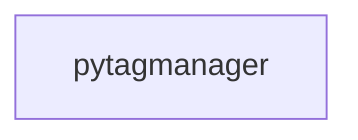

_Generated by CodeAtlas._

## Details

Owns 0 symbols across 0 file(s).

### pytagmanager

Owns 8 symbols across 2 file(s).

**Related Classes/Methods:** _None_

**Source Files:**

- `python/pytagmanager/cli.py`
  - `python.pytagmanager.cli._parse_headers`
  - `python.pytagmanager.cli.crawl`
  - `python.pytagmanager.cli.data_dictionary`
  - `python.pytagmanager.cli.diagnose`
  - `python.pytagmanager.cli.diff`
  - `python.pytagmanager.cli.main`
  - `python.pytagmanager.cli.perf`
  - `python.pytagmanager.cli.scan_tags`
