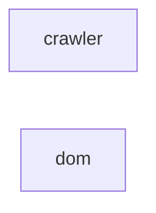

_Generated by CodeAtlas._

## Details

Owns 7 symbols across 2 file(s).

### crawler

Owns 19 symbols across 3 file(s).

**Related Classes/Methods:** _None_

**Source Files:**

- `src/crawler/orchestrator.rs`
  - `src.crawler.orchestrator.BrowserMode`
  - `src.crawler.orchestrator.BrowserMode.parse`
  - `src.crawler.orchestrator.Cookie`
  - `src.crawler.orchestrator.Cookie.from`
  - `src.crawler.orchestrator.NetworkRequest`
  - `src.crawler.orchestrator.NetworkRequest.from`
  - `src.crawler.orchestrator.Page`
  - `src.crawler.orchestrator.Page.__repr__`
  - `src.crawler.orchestrator.build_config`
  - `src.crawler.orchestrator.crawl`
  - `src.crawler.orchestrator.crawl_with_config`
  - `src.crawler.orchestrator.read_scope_host`
  - `src.crawler.orchestrator.seed_from_sitemap`
  - `src.crawler.orchestrator.update_scope_host`
- `src/crawler/sitemap.rs`
  - `src.crawler.sitemap.SitemapContent`
  - `src.crawler.sitemap.parse_sitemap`
  - `src.crawler.sitemap.tests.invalid_xml_returns_none`
  - `src.crawler.sitemap.tests.parses_sitemap_index`
  - `src.crawler.sitemap.tests.parses_urlset`

### dom

Owns 17 symbols across 4 file(s).

**Related Classes/Methods:** _None_

**Source Files:**

- `src/dom/graph.rs`
  - `src.dom.graph.SemanticGraph`
  - `src.dom.graph.SemanticGraph.__len__`
  - `src.dom.graph.SemanticGraph.__repr__`
  - `src.dom.graph.SemanticGraph.find_by_tag`
  - `src.dom.graph.SemanticNode`
  - `src.dom.graph.SemanticNode.__repr__`
- `src/dom/parser.rs`
  - `src.dom.parser.parse_html`
  - `src.dom.parser.sibling_index_all`
  - `src.dom.parser.sibling_index_by_tag`
  - `src.dom.parser.tests.parses_basic_page_structure`
  - `src.dom.parser.walk`
- `src/dom/selectors.rs`
  - `src.dom.selectors.compute_stable_selector`
  - `src.dom.selectors.tests.attrs`
  - `src.dom.selectors.tests.falls_back_to_aria_label_then_id`
  - `src.dom.selectors.tests.falls_back_to_sorted_data_attr`
  - `src.dom.selectors.tests.none_when_nothing_stable`
  - `src.dom.selectors.tests.prefers_data_testid_over_id`
