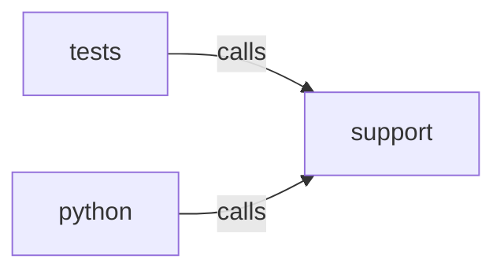

_Generated by CodeAtlas._

## Details

Owns 22 symbols across 2 file(s).

### python

Owns 522 symbols across 64 file(s).

**Related Classes/Methods:** _None_

**Source Files:**

- `tests/python/conftest.py`
  - `tests.python.conftest._CapturingWebhookHandler`
  - `tests.python.conftest._CapturingWebhookHandler.do_POST`
  - `tests.python.conftest._CapturingWebhookHandler.log_message`
  - `tests.python.conftest._QuietHandler`
  - `tests.python.conftest._QuietHandler.log_message`
  - `tests.python.conftest.capturing_webhook_server`
  - `tests.python.conftest.fixture_server`
- `tests/python/test_analytics_api_clients.py`
  - `tests.python.test_analytics_api_clients._FakeExecutable`
  - `tests.python.test_analytics_api_clients._FakeExecutable.__init__`
  - `tests.python.test_analytics_api_clients._FakeExecutable.execute`
  - `tests.python.test_analytics_api_clients._FakeGa4AdminService`
  - `tests.python.test_analytics_api_clients._FakeGa4AdminService.__init__`
  - `tests.python.test_analytics_api_clients._FakeGa4AdminService.conversionEvents`
  - `tests.python.test_analytics_api_clients._FakeGa4AdminService.customDimensions`
  - `tests.python.test_analytics_api_clients._FakeGa4AdminService.list`
  - `tests.python.test_analytics_api_clients._FakeGa4AdminService.properties`
  - `tests.python.test_analytics_api_clients._FakeGa4DataService`
  - `tests.python.test_analytics_api_clients._FakeGa4DataService.__init__`
  - `tests.python.test_analytics_api_clients._FakeGa4DataService.properties`
  - `tests.python.test_analytics_api_clients._FakeGa4DataService.runRealtimeReport`
  - `tests.python.test_analytics_api_clients._FakeGtmService`
  - `tests.python.test_analytics_api_clients._FakeGtmService.__init__`
  - `tests.python.test_analytics_api_clients._FakeGtmService.accounts`
  - `tests.python.test_analytics_api_clients._FakeGtmService.containers`
  - `tests.python.test_analytics_api_clients._FakeGtmService.list`
  - `tests.python.test_analytics_api_clients._FakeGtmService.live`
  - `tests.python.test_analytics_api_clients._FakeGtmService.versions`
  - `tests.python.test_analytics_api_clients.test_find_container_by_public_id`
  - `tests.python.test_analytics_api_clients.test_ga4_list_custom_dimensions_and_conversion_events`
  - `tests.python.test_analytics_api_clients.test_ga4_realtime_ingestion_confirmation`
  - `tests.python.test_analytics_api_clients.test_ga4_realtime_ingestion_returns_none_on_api_error`
  - `tests.python.test_analytics_api_clients.test_ga4_realtime_ingestion_returns_none_on_api_error._BrokenDataService`
  - `tests.python.test_analytics_api_clients.test_ga4_realtime_ingestion_returns_none_on_api_error._BrokenDataService.properties`
  - `tests.python.test_analytics_api_clients.test_get_live_container_config_normalizes_trigger_and_tag`
- `tests/python/test_cli.py`
  - `tests.python.test_cli.FakeGraph`
  - `tests.python.test_cli.FakeGraph.__init__`
  - `tests.python.test_cli.FakeNode`
  - `tests.python.test_cli.FakeNode.__init__`
  - `tests.python.test_cli.FakePage`
  - `tests.python.test_cli.FakePage.__init__`
  - `tests.python.test_cli._page_with_cta`
  - `tests.python.test_cli._page_with_no_recommendations`
  - `tests.python.test_cli.runner`
  - `tests.python.test_cli.test_crawl_defaults_respect_robots_true`
  - `tests.python.test_cli.test_crawl_export_gtm_with_output_writes_file`
  - `tests.python.test_cli.test_crawl_export_gtm_without_output_prints_json_to_stdout`
  - `tests.python.test_cli.test_crawl_export_writes_file_for_every_supported_format`
  - `tests.python.test_cli.test_crawl_intent_defaults_to_heuristic_with_no_classifier`
  - `tests.python.test_cli.test_crawl_intent_defaults_to_heuristic_with_no_classifier.fake_recommend_for_graph`
  - `tests.python.test_cli.test_crawl_intent_ollama_constructs_classifier_and_passes_it_to_recommend`
  - `tests.python.test_cli.test_crawl_intent_ollama_constructs_classifier_and_passes_it_to_recommend.FakeOllamaIntentClassifier`
  - `tests.python.test_cli.test_crawl_intent_ollama_constructs_classifier_and_passes_it_to_recommend.FakeOllamaIntentClassifier.__init__`
  - `tests.python.test_cli.test_crawl_intent_ollama_constructs_classifier_and_passes_it_to_recommend.fake_recommend_for_graph`
  - `tests.python.test_cli.test_crawl_output_option_without_export_is_a_no_op`
  - `tests.python.test_cli.test_crawl_passes_options_through_to_crawl_site`
  - `tests.python.test_cli.test_crawl_passes_options_through_to_crawl_site.fake_crawl_site`
  - `tests.python.test_cli.test_crawl_passes_rate_limit_and_headers_through_to_crawl_site`
  - `tests.python.test_cli.test_crawl_passes_rate_limit_and_headers_through_to_crawl_site.fake_crawl_site`
  - `tests.python.test_cli.test_crawl_rejects_malformed_header`
  - `tests.python.test_cli.test_crawl_rejects_unsupported_export_format`
  - `tests.python.test_cli.test_crawl_rejects_unsupported_export_format.fake_crawl_site`
  - `tests.python.test_cli.test_crawl_save_snapshot_writes_loadable_snapshot_file`
  - `tests.python.test_cli.test_crawl_truncates_recommendation_list_beyond_twenty`
  - `tests.python.test_cli.test_crawl_with_no_recommendations`
  - `tests.python.test_cli.test_crawl_without_export_prints_recommendation_summary`
  - `tests.python.test_cli.test_diff_command_reports_added_page`
  - `tests.python.test_cli.test_main_group_shows_help`
- `tests/python/test_cli_render.py`
  - `tests.python.test_cli_render.test_crawl_render_flag_finds_recommendation_static_crawl_would_miss`
  - `tests.python.test_cli_render.test_crawl_render_flag_with_sniff_and_interactions`
- `tests/python/test_core_ffi.py`
  - `tests.python.test_core_ffi._internet_reachable`
  - `tests.python.test_core_ffi.test_core_find_by_tag_is_case_insensitive`
  - `tests.python.test_core_ffi.test_crawl_rejects_cloud_metadata_address_across_ffi`
  - `tests.python.test_core_ffi.test_crawl_returns_real_page_objects_over_ffi`
  - `tests.python.test_core_ffi.test_crawl_ssrf_guard_rejects_loopback_across_ffi`
  - `tests.python.test_core_ffi.test_parse_html_marshals_semantic_graph_and_node_across_ffi`
- `tests/python/test_correlation.py`
  - `tests.python.test_correlation._event`
  - `tests.python.test_correlation.test_correlate_events_does_not_merge_across_next_interaction`
  - `tests.python.test_correlation.test_correlate_events_groups_by_interaction_anchor`
  - `tests.python.test_correlation.test_correlate_events_handles_simultaneous_anchors_with_identical_timestamps`
  - `tests.python.test_correlation.test_correlate_events_no_interactions_yields_no_journeys`
  - `tests.python.test_correlation.test_correlate_events_respects_window_boundary`
- `tests/python/test_diagnose_cli.py`
  - `tests.python.test_diagnose_cli.test_diagnose_json_format`
  - `tests.python.test_diagnose_cli.test_diagnose_text_format`
  - `tests.python.test_diagnose_cli.test_diagnose_trace_flag_includes_interaction_trace_json`
  - `tests.python.test_diagnose_cli.test_diagnose_track_scroll_depth_flag_is_accepted_and_does_not_break_the_run`
  - `tests.python.test_diagnose_cli.test_diagnose_without_trace_flag_omits_interaction_traces`
- `tests/python/test_diagnose_duplicate_tags_cli.py`
  - `tests.python.test_diagnose_duplicate_tags_cli.test_detect_duplicate_tags_flags_finding_on_real_duplicate_page`
  - `tests.python.test_diagnose_duplicate_tags_cli.test_without_flag_no_duplicate_tag_findings_reported`
- `tests/python/test_diagnose_server_side_cli.py`
  - `tests.python.test_diagnose_server_side_cli.test_detect_server_side_tagging_flags_indicators_on_real_page`
  - `tests.python.test_diagnose_server_side_cli.test_without_flag_no_server_side_indicators_reported`
- `tests/python/test_diagnose_site_wide_cli.py`
  - `tests.python.test_diagnose_site_wide_cli._fake_page`
  - `tests.python.test_diagnose_site_wide_cli.test_diagnose_rejects_alert_webhook_without_history`
  - `tests.python.test_diagnose_site_wide_cli.test_diagnose_rejects_history_without_site_wide`
  - `tests.python.test_diagnose_site_wide_cli.test_diagnose_site_wide_history_detects_regression_and_alerts`
  - `tests.python.test_diagnose_site_wide_cli.test_diagnose_site_wide_history_records_first_run`
  - `tests.python.test_diagnose_site_wide_cli.test_diagnose_site_wide_json`
  - `tests.python.test_diagnose_site_wide_cli.test_diagnose_site_wide_rejects_scenario_combo`
  - `tests.python.test_diagnose_site_wide_cli.test_diagnose_site_wide_semantic_labels`
  - `tests.python.test_diagnose_site_wide_cli.test_diagnose_site_wide_text`
- `tests/python/test_diagnose_tag_graph_cli.py`
  - `tests.python.test_diagnose_tag_graph_cli.test_tag_graph_assembles_nodes_and_edges_from_a_real_page`
  - `tests.python.test_diagnose_tag_graph_cli.test_without_tag_graph_flag_no_graph_reported`
- `tests/python/test_diagnose_test_candidates_cli.py`
  - `tests.python.test_diagnose_test_candidates_cli.test_test_candidates_generated_from_a_real_missing_event_finding`
  - `tests.python.test_diagnose_test_candidates_cli.test_without_flag_no_test_candidates_reported`
- `tests/python/test_diagnostics_rules.py`
  - `tests.python.test_diagnostics_rules._event`
  - `tests.python.test_diagnostics_rules._event_at`
  - `tests.python.test_diagnostics_rules._journey`
  - `tests.python.test_diagnostics_rules.test_consent_blocking_detected`
  - `tests.python.test_diagnostics_rules.test_ecommerce_missing_parameters_flags_incomplete_purchase`
  - `tests.python.test_diagnostics_rules.test_ecommerce_missing_parameters_silent_for_non_ecommerce_events`
  - `tests.python.test_diagnostics_rules.test_find_duplicate_purchases_across_journeys`
  - `tests.python.test_diagnostics_rules.test_find_duplicate_purchases_ignores_distinct_transactions`
  - `tests.python.test_diagnostics_rules.test_find_untested_recommendations_filters_by_selector`
  - `tests.python.test_diagnostics_rules.test_gtm_tag_not_executed_when_trigger_matches_but_nothing_downstream`
  - `tests.python.test_diagnostics_rules.test_healthy_journey_with_full_gtm_config_produces_no_diagnosis`
  - `tests.python.test_diagnostics_rules.test_pii_leak_detected_in_datalayer_payload`
  - `tests.python.test_diagnostics_rules.test_state_diff_for_journey_normalizes_quote_style`
  - `tests.python.test_diagnostics_rules.test_state_diff_for_journey_picks_closest_by_time_among_repeated_selector`
  - `tests.python.test_diagnostics_rules.test_timing_delay_flagged_when_state_changes_well_after_event_fires`
  - `tests.python.test_diagnostics_rules.test_timing_delay_not_flagged_when_no_state_changed`
  - `tests.python.test_diagnostics_rules.test_timing_delay_not_flagged_within_threshold`
  - `tests.python.test_diagnostics_rules.test_timing_delay_not_flagged_without_matching_selector`
- `tests/python/test_dictionary.py`
  - `tests.python.test_dictionary._fake_page`
  - `tests.python.test_dictionary._snapshot`
  - `tests.python.test_dictionary.test_aggregates_cookies_across_pages_with_presence_ratio`
  - `tests.python.test_dictionary.test_datalayer_events_and_fields_are_tracked_separately`
  - `tests.python.test_dictionary.test_dictionary_cli_compare_to_reports_no_drift_for_identical_runs`
  - `tests.python.test_dictionary.test_dictionary_cli_end_to_end_json`
  - `tests.python.test_dictionary.test_dictionary_cli_presence_labels_and_purpose_classifier`
  - `tests.python.test_dictionary.test_empty_snapshot_list_produces_empty_dictionary`
  - `tests.python.test_dictionary.test_multiple_snapshots_of_the_same_page_do_not_inflate_pages_total`
  - `tests.python.test_dictionary.test_report_and_json_rendering_do_not_crash_on_empty_dictionary`
  - `tests.python.test_dictionary.test_report_rendering_includes_observed_variable`
  - `tests.python.test_dictionary.test_value_type_changing_across_pages_is_recorded_as_multiple_types`
- `tests/python/test_dictionary_labels.py`
  - `tests.python.test_dictionary_labels._variable`
  - `tests.python.test_dictionary_labels.test_cookie_is_not_exposed_but_accessible_via_builtin_variable`
  - `tests.python.test_dictionary_labels.test_datalayer_event_is_exposed_and_accessible`
  - `tests.python.test_dictionary_labels.test_datalayer_field_is_exposed_and_accessible`
  - `tests.python.test_dictionary_labels.test_local_storage_is_only_possibly_accessible`
  - `tests.python.test_dictionary_labels.test_session_storage_is_only_possibly_accessible`
- `tests/python/test_dictionary_purpose.py`
  - `tests.python.test_dictionary_purpose._variable`
  - `tests.python.test_dictionary_purpose.test_campaign_url_param_cooccurrence_is_recorded_as_evidence`
  - `tests.python.test_dictionary_purpose.test_classifies_advertising_cookie`
  - `tests.python.test_dictionary_purpose.test_classifies_cart_cookie`
  - `tests.python.test_dictionary_purpose.test_classifies_consent_cookie`
  - `tests.python.test_dictionary_purpose.test_classifies_session_cookie`
  - `tests.python.test_dictionary_purpose.test_ollama_classifier_falls_back_to_heuristic_when_unreachable`
  - `tests.python.test_dictionary_purpose.test_persistence_across_pages_is_recorded_as_evidence`
  - `tests.python.test_dictionary_purpose.test_unrecognized_key_with_no_evidence_is_unknown_with_zero_confidence`
- `tests/python/test_dictionary_schema_drift.py`
  - `tests.python.test_dictionary_schema_drift._snapshot`
  - `tests.python.test_dictionary_schema_drift.test_added_field_is_reported`
  - `tests.python.test_dictionary_schema_drift.test_json_roundtrip_via_data_dictionary_from_json`
  - `tests.python.test_dictionary_schema_drift.test_nested_field_restructure_is_flagged_as_possible_rename`
  - `tests.python.test_dictionary_schema_drift.test_no_changes_reports_no_drift`
  - `tests.python.test_dictionary_schema_drift.test_removed_field_is_reported`
  - `tests.python.test_dictionary_schema_drift.test_similar_leaf_name_rename_is_detected_by_string_similarity`
  - `tests.python.test_dictionary_schema_drift.test_type_distribution_shift_is_detected`
  - `tests.python.test_dictionary_schema_drift.test_unrelated_add_and_remove_across_different_events_is_not_a_rename`
- `tests/python/test_dictionary_test_candidates_cli.py`
  - `tests.python.test_dictionary_test_candidates_cli._fake_page`
  - `tests.python.test_dictionary_test_candidates_cli.test_regression_test_candidate_generated_for_removed_price_field`
  - `tests.python.test_dictionary_test_candidates_cli.test_without_test_candidates_flag_compare_to_omits_the_key`
- `tests/python/test_discovery_crawl_rendered.py`
  - `tests.python.test_discovery_crawl_rendered.test_crawl_site_rendered_builds_graph_from_rendered_html`
  - `tests.python.test_discovery_crawl_rendered.test_crawl_site_rendered_with_all_optional_observations_enabled`
- `tests/python/test_event_map.py`
  - `tests.python.test_event_map._event`
  - `tests.python.test_event_map._journey`
  - `tests.python.test_event_map.test_distinct_business_events_produce_separate_rows`
  - `tests.python.test_event_map.test_empty_journeys_produces_empty_map`
  - `tests.python.test_event_map.test_full_chain_journey_has_full_coverage`
  - `tests.python.test_event_map.test_groups_by_business_event_across_multiple_journeys`
  - `tests.python.test_event_map.test_partial_chain_journey_has_partial_coverage`
  - `tests.python.test_event_map.test_stage_coverage_property_matches_fields`
- `tests/python/test_exporters.py`
  - `tests.python.test_exporters._all_heuristic_objectives`
  - `tests.python.test_exporters._minimal_rec`
  - `tests.python.test_exporters._sample_recs`
  - `tests.python.test_exporters.test_adobe_launch_rules_use_real_core_extension_module_paths`
  - `tests.python.test_exporters.test_all_exporters_registered_and_handle_empty_input`
  - `tests.python.test_exporters.test_canonical_map_covers_every_heuristic_objective`
  - `tests.python.test_exporters.test_every_canonical_event_has_an_exporter_spec_entry`
  - `tests.python.test_exporters.test_export_adobe_tags_json_writes_valid_json_file`
  - `tests.python.test_exporters.test_export_ga4_json_writes_valid_json_file`
  - `tests.python.test_exporters.test_export_rudderstack_json_writes_valid_json_file`
  - `tests.python.test_exporters.test_export_segment_json_writes_valid_json_file`
  - `tests.python.test_exporters.test_export_snowplow_json_writes_valid_json_file`
  - `tests.python.test_exporters.test_export_tealium_json_writes_valid_json_file`
  - `tests.python.test_exporters.test_ga4_config_empty_input`
  - `tests.python.test_exporters.test_ga4_config_uses_recommended_event_names_and_params`
  - `tests.python.test_exporters.test_ga4_unknown_business_objective_falls_back_to_default_event`
  - `tests.python.test_exporters.test_new_taxonomy_events_export_real_names`
  - `tests.python.test_exporters.test_ollama_taxonomy_matches_heuristic_taxonomy`
  - `tests.python.test_exporters.test_rudderstack_tracking_plan_shape`
  - `tests.python.test_exporters.test_segment_tracking_plan_shape_and_ecommerce_spec_name`
  - `tests.python.test_exporters.test_snowplow_schemas_are_valid_iglu_self_describing_documents`
  - `tests.python.test_exporters.test_snowplow_schemas_deduplicated_per_canonical_event`
  - `tests.python.test_exporters.test_tealium_profile_udo_events_and_load_rules`
- `tests/python/test_gtm_export.py`
  - `tests.python.test_gtm_export._sample_recs`
  - `tests.python.test_gtm_export.test_build_gtm_container_empty_input`
  - `tests.python.test_gtm_export.test_build_gtm_container_shape`
  - `tests.python.test_gtm_export.test_export_gtm_json_writes_valid_json_file`
- `tests/python/test_heuristics.py`
  - `tests.python.test_heuristics._FakeClassifier`
  - `tests.python.test_heuristics._FakeClassifier.__init__`
  - `tests.python.test_heuristics._FakeClassifier.classify`
  - `tests.python.test_heuristics._by_event`
  - `tests.python.test_heuristics._recommendations`
  - `tests.python.test_heuristics._recs_for_html`
  - `tests.python.test_heuristics._recs_for_html_with_classifier`
  - `tests.python.test_heuristics.test_add_to_cart_uses_stable_selector`
  - `tests.python.test_heuristics.test_aria_role_menuitem_is_detected`
  - `tests.python.test_heuristics.test_aria_role_tab_is_detected_even_without_button_or_link_tag`
  - `tests.python.test_heuristics.test_contact_link_classified_as_lead_generation`
  - `tests.python.test_heuristics.test_download_link_classified_as_content_engagement`
  - `tests.python.test_heuristics.test_finds_expected_recommendation_count`
  - `tests.python.test_heuristics.test_form_element_produces_form_submission_recommendation`
  - `tests.python.test_heuristics.test_new_keyword_categories_are_classified`
  - `tests.python.test_heuristics.test_plain_div_without_interactive_role_is_not_classified`
  - `tests.python.test_heuristics.test_recommend_for_graph_skips_none_objective_from_classifier`
  - `tests.python.test_heuristics.test_recommend_for_graph_uses_classifier_when_provided`
  - `tests.python.test_heuristics.test_subscribe_button_classified_as_subscription`
  - `tests.python.test_heuristics.test_unrelated_elements_produce_no_recommendation`
- `tests/python/test_intent_ollama.py`
  - `tests.python.test_intent_ollama._add_to_cart_node`
  - `tests.python.test_intent_ollama._context`
  - `tests.python.test_intent_ollama._ollama_reachable`
  - `tests.python.test_intent_ollama.test_classify_fallback_returns_none_objective_for_unmatched_element`
  - `tests.python.test_intent_ollama.test_classify_falls_back_to_heuristic_when_ollama_unavailable`
  - `tests.python.test_intent_ollama.test_classify_handles_unrelated_element_without_crashing`
  - `tests.python.test_intent_ollama.test_classify_returns_real_ollama_response_for_add_to_cart_button`
  - `tests.python.test_intent_ollama.test_is_available_false_for_unreachable_host`
  - `tests.python.test_intent_ollama.test_is_available_true_when_ollama_running`
- `tests/python/test_interaction_consistency.py`
  - `tests.python.test_interaction_consistency._fake_page`
  - `tests.python.test_interaction_consistency._fired_journey`
  - `tests.python.test_interaction_consistency._rec`
  - `tests.python.test_interaction_consistency._silent_journey`
  - `tests.python.test_interaction_consistency.test_diagnose_site_wide_detects_add_to_cart_naming_inconsistency`
  - `tests.python.test_interaction_consistency.test_diagnose_site_wide_text_shows_inconsistency_section`
  - `tests.python.test_interaction_consistency.test_different_business_objectives_are_not_compared_to_each_other`
  - `tests.python.test_interaction_consistency.test_different_event_names_across_pages_is_inconsistent`
  - `tests.python.test_interaction_consistency.test_same_event_name_across_pages_is_consistent`
  - `tests.python.test_interaction_consistency.test_silent_implementation_does_not_count_against_naming_consistency`
  - `tests.python.test_interaction_consistency.test_single_implementation_is_not_reported_at_all`
- `tests/python/test_interaction_trace.py`
  - `tests.python.test_interaction_trace._event`
  - `tests.python.test_interaction_trace._journey`
  - `tests.python.test_interaction_trace.test_build_interaction_trace_json_is_serializable`
  - `tests.python.test_interaction_trace.test_build_interaction_traces_joins_by_journey_id`
  - `tests.python.test_interaction_trace.test_render_interaction_trace_is_human_readable`
  - `tests.python.test_interaction_trace.test_trace_carries_finding_and_confidence_from_diagnosis`
  - `tests.python.test_interaction_trace.test_trace_includes_storage_changes_from_correlated_state_diff`
  - `tests.python.test_interaction_trace.test_trace_orders_steps_by_timestamp_and_labels_stages`
  - `tests.python.test_interaction_trace.test_trace_with_no_diagnosis_has_no_finding`
  - `tests.python.test_interaction_trace.test_trace_without_state_diff_has_no_storage_changes`
- `tests/python/test_notify_backoff.py`
  - `tests.python.test_notify_backoff.test_backoff_grows_and_is_bounded`
  - `tests.python.test_notify_backoff.test_backoff_honors_retry_after_and_clamps`
- `tests/python/test_observability_extended_observers.py`
  - `tests.python.test_observability_extended_observers.test_console_error_observed_as_js_error`
  - `tests.python.test_observability_extended_observers.test_fetch_call_observed_and_tracking_gap_detected`
  - `tests.python.test_observability_extended_observers.test_fetch_call_with_tracking_produces_no_api_gap_diagnosis`
  - `tests.python.test_observability_extended_observers.test_mutation_dedup_resets_after_spa_route_change`
  - `tests.python.test_observability_extended_observers.test_redact_payload_still_masks_sensitive_keys_in_api_call_payloads`
  - `tests.python.test_observability_extended_observers.test_scroll_depth_becomes_a_journey_anchor`
  - `tests.python.test_observability_extended_observers.test_scroll_depth_milestones_observed_when_scrolled_to_bottom`
  - `tests.python.test_observability_extended_observers.test_scroll_depth_not_tracked_when_disabled`
  - `tests.python.test_observability_extended_observers.test_visibility_observed_when_element_scrolled_into_view`
- `tests/python/test_observability_pipeline.py`
  - `tests.python.test_observability_pipeline._run`
  - `tests.python.test_observability_pipeline.test_duplicate_tracking_detected`
  - `tests.python.test_observability_pipeline.test_event_name_mismatch_detected`
  - `tests.python.test_observability_pipeline.test_healthy_tracking_produces_no_diagnosis`
  - `tests.python.test_observability_pipeline.test_missing_datalayer_event_detected`
  - `tests.python.test_observability_pipeline.test_missing_ga4_request_detected`
  - `tests.python.test_observability_pipeline.test_spa_navigation_missing_pageview_detected`
- `tests/python/test_observability_state.py`
  - `tests.python.test_observability_state._snapshot`
  - `tests.python.test_observability_state.test_capture_storage_values_opt_in_reveals_values_except_sensitive_keys`
  - `tests.python.test_observability_state.test_data_layer_snapshot_reflects_full_object_not_just_the_pushed_event`
  - `tests.python.test_observability_state.test_diff_detects_added_removed_and_modified_keys`
  - `tests.python.test_observability_state.test_diff_finds_new_data_layer_events_regardless_of_order`
  - `tests.python.test_observability_state.test_diff_is_empty_when_nothing_changed`
  - `tests.python.test_observability_state.test_from_raw_redacts_sensitive_storage_keys_by_default`
  - `tests.python.test_observability_state.test_interaction_diff_captures_new_cookie_storage_and_datalayer_event`
  - `tests.python.test_observability_state.test_is_sensitive_key_matches_session_and_csrf_markers`
  - `tests.python.test_observability_state.test_page_load_snapshot_captures_cookie_and_local_storage`
  - `tests.python.test_observability_state.test_redact_payload_still_works_for_dict_payloads`
  - `tests.python.test_observability_state.test_session_cookie_value_is_redacted_even_with_capture_values_on`
- `tests/python/test_perf_cli.py`
  - `tests.python.test_perf_cli.test_perf_baseline_only_reports_real_metrics`
  - `tests.python.test_perf_cli.test_perf_history_and_test_candidates_flow`
  - `tests.python.test_perf_cli.test_perf_isolate_group_targets_only_classified_scripts`
  - `tests.python.test_perf_cli.test_perf_isolate_reproduces_exit_criteria`
  - `tests.python.test_perf_cli.test_perf_mutually_exclusive_isolate_flags_rejected`
- `tests/python/test_perf_dependency_graph.py`
  - `tests.python.test_perf_dependency_graph._entry`
  - `tests.python.test_perf_dependency_graph.test_children_of_returns_direct_children_only`
  - `tests.python.test_perf_dependency_graph.test_downstream_of_computes_transitive_closure`
  - `tests.python.test_perf_dependency_graph.test_downstream_of_handles_cycles_without_infinite_loop`
  - `tests.python.test_perf_dependency_graph.test_downstream_of_leaf_script_is_empty`
  - `tests.python.test_perf_dependency_graph.test_empty_inventory_produces_empty_graph`
  - `tests.python.test_perf_dependency_graph.test_parser_initiated_script_is_parented_to_the_page`
  - `tests.python.test_perf_dependency_graph.test_script_initiated_script_is_parented_to_the_initiator`
  - `tests.python.test_perf_dependency_graph.test_script_initiator_with_no_resolvable_url_falls_back_to_page`
- `tests/python/test_perf_dependency_graph_e2e.py`
  - `tests.python.test_perf_dependency_graph_e2e.test_dependency_graph_from_a_real_script_inventory`
- `tests/python/test_perf_environment_config.py`
  - `tests.python.test_perf_environment_config.test_cpu_throttling_measurably_increases_busy_wait_duration`
  - `tests.python.test_perf_environment_config.test_default_environment_is_persisted_on_the_baseline`
  - `tests.python.test_perf_environment_config.test_explicit_environment_run_count_is_overridden_by_actual_runs`
- `tests/python/test_perf_experiments_e2e.py`
  - `tests.python.test_perf_experiments_e2e.test_isolation_experiments_against_a_real_fixture`
- `tests/python/test_perf_experiments_unit.py`
  - `tests.python.test_perf_experiments_unit._script`
  - `tests.python.test_perf_experiments_unit._snapshot`
  - `tests.python.test_perf_experiments_unit.test_available_groups_empty_when_nothing_classifiable`
  - `tests.python.test_perf_experiments_unit.test_available_groups_reflects_only_whats_present`
  - `tests.python.test_perf_experiments_unit.test_closure_includes_downstream_scripts`
  - `tests.python.test_perf_experiments_unit.test_closure_of_multiple_seed_urls_unions_their_downstream_sets`
  - `tests.python.test_perf_experiments_unit.test_delta_is_none_when_baseline_or_experiment_missing`
  - `tests.python.test_perf_experiments_unit.test_deltas_computed_as_baseline_minus_experiment`
  - `tests.python.test_perf_experiments_unit.test_message_handles_no_measurable_change`
  - `tests.python.test_perf_experiments_unit.test_message_reports_observed_impact_not_causal_claim`
  - `tests.python.test_perf_experiments_unit.test_script_group_falls_back_to_vendor_category`
  - `tests.python.test_perf_experiments_unit.test_script_group_matches_gtm_loader_url`
  - `tests.python.test_perf_experiments_unit.test_script_group_none_for_unclassified_first_party_script`
- `tests/python/test_perf_history.py`
  - `tests.python.test_perf_history._baseline`
  - `tests.python.test_perf_history._entry`
  - `tests.python.test_perf_history.test_from_baseline_captures_medians_and_scripts`
  - `tests.python.test_perf_history.test_history_round_trips_through_disk`
  - `tests.python.test_perf_history.test_improvement_is_not_a_regression`
  - `tests.python.test_perf_history.test_lcp_regression_above_threshold_is_detected`
  - `tests.python.test_perf_history.test_newly_introduced_script_is_correlated_in_the_message`
  - `tests.python.test_perf_history.test_no_history_produces_no_alerts`
  - `tests.python.test_perf_history.test_small_change_below_threshold_is_not_a_regression`
- `tests/python/test_perf_measure.py`
  - `tests.python.test_perf_measure._snapshot`
  - `tests.python.test_perf_measure.test_all_none_lcp_across_runs_produces_none_median`
  - `tests.python.test_perf_measure.test_empty_baseline_medians_are_none`
  - `tests.python.test_perf_measure.test_from_raw_handles_missing_fields_with_safe_defaults`
  - `tests.python.test_perf_measure.test_from_raw_maps_camel_case_js_fields`
  - `tests.python.test_perf_measure.test_median_across_three_runs`
  - `tests.python.test_perf_measure.test_median_ignores_none_values`
- `tests/python/test_perf_measure_e2e.py`
  - `tests.python.test_perf_measure_e2e.test_block_url_patterns_prevents_a_request_from_completing`
  - `tests.python.test_perf_measure_e2e.test_heavy_fixture_registers_a_real_long_task`
  - `tests.python.test_perf_measure_e2e.test_measures_real_metrics_from_a_heavy_fixture_page`
  - `tests.python.test_perf_measure_e2e.test_runs_parameter_controls_the_number_of_page_loads`
- `tests/python/test_perf_report.py`
  - `tests.python.test_perf_report._baseline`
  - `tests.python.test_perf_report._tradeoff`
  - `tests.python.test_perf_report.test_build_performance_report_json_structure`
  - `tests.python.test_perf_report.test_empty_tradeoffs_ranks_to_empty`
  - `tests.python.test_perf_report.test_ranks_highest_cost_first`
  - `tests.python.test_perf_report.test_render_performance_report_includes_ranked_scripts`
  - `tests.python.test_perf_report.test_render_performance_report_includes_url_and_metrics`
  - `tests.python.test_perf_report.test_summarize_template_performance_picks_top_contributors`
  - `tests.python.test_perf_report.test_summarize_template_performance_with_no_tradeoffs`
  - `tests.python.test_perf_report.test_untested_scripts_sort_last_not_first`
- `tests/python/test_perf_scripts.py`
  - `tests.python.test_perf_scripts.test_dynamically_injected_vendor_script_has_script_initiator_and_vendor_classification`
  - `tests.python.test_perf_scripts.test_first_party_async_script_is_classified_correctly`
  - `tests.python.test_perf_scripts.test_third_party_scripts_property_excludes_first_party`
  - `tests.python.test_perf_scripts.test_unclassified_script_has_no_vendor_or_category`
- `tests/python/test_perf_scripts_unit.py`
  - `tests.python.test_perf_scripts_unit.test_initiator_url_from_empty_stack_falls_back_to_none`
  - `tests.python.test_perf_scripts_unit.test_initiator_url_from_parser_type_uses_url_field`
  - `tests.python.test_perf_scripts_unit.test_initiator_url_from_script_type_uses_first_stack_frame`
  - `tests.python.test_perf_scripts_unit.test_is_first_party_different_domain_is_third_party`
  - `tests.python.test_perf_scripts_unit.test_is_first_party_empty_hostname_is_false`
  - `tests.python.test_perf_scripts_unit.test_is_first_party_same_domain`
  - `tests.python.test_perf_scripts_unit.test_is_first_party_subdomain_counts_as_first_party`
- `tests/python/test_perf_tagging_join.py`
  - `tests.python.test_perf_tagging_join._script`
  - `tests.python.test_perf_tagging_join.test_classified_script_produces_a_tradeoff_entry`
  - `tests.python.test_perf_tagging_join.test_matches_graph_node_by_vendor_label`
  - `tests.python.test_perf_tagging_join.test_matching_isolation_result_supplies_cost_deltas`
  - `tests.python.test_perf_tagging_join.test_matching_isolation_result_supplies_cost_deltas.snap`
  - `tests.python.test_perf_tagging_join.test_no_graph_node_match_is_none`
  - `tests.python.test_perf_tagging_join.test_no_matching_result_leaves_cost_fields_none_not_zero`
  - `tests.python.test_perf_tagging_join.test_unclassified_scripts_are_excluded`
- `tests/python/test_perf_test_candidates.py`
  - `tests.python.test_perf_test_candidates._result`
  - `tests.python.test_perf_test_candidates._snap`
  - `tests.python.test_perf_test_candidates.test_no_alerts_produces_no_candidates`
  - `tests.python.test_perf_test_candidates.test_regression_alert_produces_a_candidate`
  - `tests.python.test_perf_test_candidates.test_result_exceeding_budget_produces_a_candidate`
  - `tests.python.test_perf_test_candidates.test_result_with_no_delta_produces_no_candidate`
  - `tests.python.test_perf_test_candidates.test_result_within_budget_produces_no_candidate`
  - `tests.python.test_perf_test_candidates.test_severity_never_confirmed_defect`
- `tests/python/test_runtime_interactions.py`
  - `tests.python.test_runtime_interactions.test_simulate_interactions_bounds_to_top_n_deduplicated_selectors`
  - `tests.python.test_runtime_interactions.test_simulate_interactions_observes_click_mutation_and_network_request`
  - `tests.python.test_runtime_interactions.test_simulate_interactions_reports_error_for_missing_selector_without_aborting`
- `tests/python/test_runtime_renderer.py`
  - `tests.python.test_runtime_renderer.test_render_page_returns_post_js_html_console_and_network`
  - `tests.python.test_runtime_renderer.test_static_crawl_finds_nothing_but_rendered_crawl_finds_the_cta`
- `tests/python/test_runtime_screenshots.py`
  - `tests.python.test_runtime_screenshots.test_capture_page_screenshots_writes_four_real_png_files`
  - `tests.python.test_runtime_screenshots.test_slug_for_url_is_filesystem_safe_and_stable`
- `tests/python/test_runtime_sniffer.py`
  - `tests.python.test_runtime_sniffer.test_sniff_page_detects_vendor_and_datalayer`
  - `tests.python.test_runtime_sniffer.test_sniff_page_reports_absent_datalayer_for_page_without_one`
- `tests/python/test_scan_tags_cli.py`
  - `tests.python.test_scan_tags_cli.test_scan_tags_json_reports_gtm_container_and_vendor`
  - `tests.python.test_scan_tags_cli.test_scan_tags_text_format_writes_readable_report`
- `tests/python/test_sitewide_aggregation.py`
  - `tests.python.test_sitewide_aggregation._journey`
  - `tests.python.test_sitewide_aggregation.test_analyze_template_consistency_flags_minority_regression`
  - `tests.python.test_sitewide_aggregation.test_analyze_template_consistency_ignores_one_off_events`
  - `tests.python.test_sitewide_aggregation.test_compute_site_health_reports_none_for_unmeasured_metrics`
  - `tests.python.test_sitewide_aggregation.test_compute_template_health_score_weighting`
  - `tests.python.test_sitewide_aggregation.test_render_and_json_report_smoke`
- `tests/python/test_sitewide_anomalies.py`
  - `tests.python.test_sitewide_anomalies._journey`
  - `tests.python.test_sitewide_anomalies.test_detects_ga4_measurement_id_drift`
  - `tests.python.test_sitewide_anomalies.test_detects_gtm_container_drift`
  - `tests.python.test_sitewide_anomalies.test_detects_unusual_event_repetition`
  - `tests.python.test_sitewide_anomalies.test_no_config_drift_when_all_pages_agree`
  - `tests.python.test_sitewide_anomalies.test_no_repetition_anomaly_with_uniform_counts`
- `tests/python/test_sitewide_history.py`
  - `tests.python.test_sitewide_history._site_health`
  - `tests.python.test_sitewide_history.test_append_and_load_history_round_trips`
  - `tests.python.test_sitewide_history.test_append_history_accumulates_entries`
  - `tests.python.test_sitewide_history.test_detect_regression_flags_site_score_drop`
  - `tests.python.test_sitewide_history.test_detect_regression_flags_template_score_drop`
  - `tests.python.test_sitewide_history.test_detect_regression_none_below_threshold`
  - `tests.python.test_sitewide_history.test_detect_regression_none_with_no_history`
  - `tests.python.test_sitewide_history.test_load_history_returns_empty_list_for_missing_file`
- `tests/python/test_sitewide_notify.py`
  - `tests.python.test_sitewide_notify._FailingHandler`
  - `tests.python.test_sitewide_notify._FailingHandler.do_POST`
  - `tests.python.test_sitewide_notify._FailingHandler.log_message`
  - `tests.python.test_sitewide_notify.failing_server`
  - `tests.python.test_sitewide_notify.test_webhook_notifier_posts_slack_compatible_payload`
  - `tests.python.test_sitewide_notify.test_webhook_notifier_returns_false_on_server_error`
  - `tests.python.test_sitewide_notify.test_webhook_notifier_returns_false_when_unreachable`
- `tests/python/test_sitewide_page_type.py`
  - `tests.python.test_sitewide_page_type._graph`
  - `tests.python.test_sitewide_page_type._ollama_reachable`
  - `tests.python.test_sitewide_page_type.test_assign_semantic_labels_keeps_original_label_when_no_graph_available`
  - `tests.python.test_sitewide_page_type.test_assign_semantic_labels_relabels_by_majority_vote`
  - `tests.python.test_sitewide_page_type.test_classify_returns_real_ollama_response`
  - `tests.python.test_sitewide_page_type.test_heuristic_classifier_falls_back_to_other`
  - `tests.python.test_sitewide_page_type.test_heuristic_classifier_matches_url_keywords`
  - `tests.python.test_sitewide_page_type.test_is_available_false_for_unreachable_host`
  - `tests.python.test_sitewide_page_type.test_ollama_classifier_falls_back_when_unavailable`
  - `tests.python.test_sitewide_page_type.test_summarize_page_extracts_headings_ctas_and_form_count`
- `tests/python/test_sitewide_templates.py`
  - `tests.python.test_sitewide_templates._FakeGraph`
  - `tests.python.test_sitewide_templates._FakeGraph.__init__`
  - `tests.python.test_sitewide_templates._FakeNode`
  - `tests.python.test_sitewide_templates._FakeNode.__init__`
  - `tests.python.test_sitewide_templates._FakePage`
  - `tests.python.test_sitewide_templates._FakePage.__init__`
  - `tests.python.test_sitewide_templates.test_detect_templates_groups_by_url_pattern`
  - `tests.python.test_sitewide_templates.test_detect_templates_merges_by_dom_fingerprint_across_different_urls`
  - `tests.python.test_sitewide_templates.test_url_template_generalizes_deep_slug_segments`
  - `tests.python.test_sitewide_templates.test_url_template_generalizes_numeric_and_uuid_segments`
- `tests/python/test_tagexec_duplicates.py`
  - `tests.python.test_tagexec_duplicates._network_step`
  - `tests.python.test_tagexec_duplicates._scan`
  - `tests.python.test_tagexec_duplicates._trace`
  - `tests.python.test_tagexec_duplicates.test_candidate_with_runtime_evidence_escalates_to_a_finding`
  - `tests.python.test_tagexec_duplicates.test_candidate_without_runtime_evidence_produces_no_finding`
  - `tests.python.test_tagexec_duplicates.test_gtm_plus_hardcoded_analytics_vendor_is_a_candidate`
  - `tests.python.test_tagexec_duplicates.test_gtm_plus_hardcoded_chat_vendor_is_not_a_candidate`
  - `tests.python.test_tagexec_duplicates.test_multiple_gtm_containers_is_a_candidate`
  - `tests.python.test_tagexec_duplicates.test_no_candidates_for_a_clean_single_implementation_page`
  - `tests.python.test_tagexec_duplicates.test_no_static_candidates_produces_no_findings_even_with_runtime_evidence`
  - `tests.python.test_tagexec_duplicates.test_runtime_evidence_computes_payload_similarity`
  - `tests.python.test_tagexec_duplicates.test_runtime_evidence_requires_at_least_two_network_requests`
  - `tests.python.test_tagexec_duplicates.test_runtime_evidence_similarity_partial_overlap`
  - `tests.python.test_tagexec_duplicates.test_same_vendor_with_distinct_evidence_is_a_duplicate_vendor_candidate`
  - `tests.python.test_tagexec_duplicates.test_single_gtm_container_is_not_a_candidate`
- `tests/python/test_tagexec_graph.py`
  - `tests.python.test_tagexec_graph._scan`
  - `tests.python.test_tagexec_graph._step`
  - `tests.python.test_tagexec_graph._trace`
  - `tests.python.test_tagexec_graph.test_build_graph_json_round_trips_structure`
  - `tests.python.test_tagexec_graph.test_duplicate_finding_with_unresolvable_name_is_skipped_gracefully`
  - `tests.python.test_tagexec_graph.test_duplicate_gtm_containers_are_linked`
  - `tests.python.test_tagexec_graph.test_empty_trace_produces_no_step_nodes`
  - `tests.python.test_tagexec_graph.test_evidence_levels_match_vision_vocabulary`
  - `tests.python.test_tagexec_graph.test_fanout_indicator_adds_suspected_edges_between_endpoints`
  - `tests.python.test_tagexec_graph.test_first_party_indicator_adds_inferred_relay_edge_for_likely_confidence`
  - `tests.python.test_tagexec_graph.test_gtm_containers_and_vendors_become_nodes`
  - `tests.python.test_tagexec_graph.test_network_step_links_to_an_endpoint_node`
  - `tests.python.test_tagexec_graph.test_no_edge_ever_uses_an_evidence_level_outside_the_vocabulary`
  - `tests.python.test_tagexec_graph.test_trace_steps_are_chained_with_observed_edges`
- `tests/python/test_tagexec_server_side.py`
  - `tests.python.test_tagexec_server_side._network_step`
  - `tests.python.test_tagexec_server_side._trace`
  - `tests.python.test_tagexec_server_side.test_analyze_server_side_indicators_across_multiple_traces`
  - `tests.python.test_tagexec_server_side.test_confidence_levels_never_include_confirmed`
  - `tests.python.test_tagexec_server_side.test_fanout_to_two_distinct_external_hosts_is_flagged`
  - `tests.python.test_tagexec_server_side.test_first_party_ga4_shaped_request_is_flagged`
  - `tests.python.test_tagexec_server_side.test_first_party_request_without_ga4_shape_is_not_flagged`
  - `tests.python.test_tagexec_server_side.test_first_party_requests_do_not_count_toward_fanout`
  - `tests.python.test_tagexec_server_side.test_first_party_subdomain_still_counts_as_first_party`
  - `tests.python.test_tagexec_server_side.test_multiple_requests_to_the_same_external_host_is_not_a_fanout`
  - `tests.python.test_tagexec_server_side.test_no_indicator_ever_emits_an_unhedged_claim`
  - `tests.python.test_tagexec_server_side.test_no_indicators_for_a_page_with_no_network_activity`
  - `tests.python.test_tagexec_server_side.test_single_external_host_is_not_a_fanout`
  - `tests.python.test_tagexec_server_side.test_third_party_ga4_request_is_not_flagged_as_first_party`
- `tests/python/test_tagexec_static_scan.py`
  - `tests.python.test_tagexec_static_scan.test_detect_delayed_containers_empty_when_present_in_both`
  - `tests.python.test_tagexec_static_scan.test_detect_delayed_containers_finds_new_container_in_later_snapshot`
  - `tests.python.test_tagexec_static_scan.test_detect_delayed_vendors_finds_new_vendor_in_later_snapshot`
  - `tests.python.test_tagexec_static_scan.test_detects_adobe_analytics_via_appmeasurement`
  - `tests.python.test_tagexec_static_scan.test_detects_ga4_via_gtag_config`
  - `tests.python.test_tagexec_static_scan.test_detects_gtm_container_from_noscript_iframe`
  - `tests.python.test_tagexec_static_scan.test_detects_gtm_container_from_rendered_script_tag`
  - `tests.python.test_tagexec_static_scan.test_detects_meta_pixel_via_fbevents_script`
  - `tests.python.test_tagexec_static_scan.test_detects_multiple_distinct_gtm_containers`
  - `tests.python.test_tagexec_static_scan.test_detects_multiple_distinct_vendors`
  - `tests.python.test_tagexec_static_scan.test_no_gtm_containers_found_returns_empty_tuple`
  - `tests.python.test_tagexec_static_scan.test_unrecognized_vendor_produces_no_detection`
  - `tests.python.test_tagexec_static_scan.test_vendor_detection_dedupes_identical_evidence`
- `tests/python/test_tagexec_static_scan_e2e.py`
  - `tests.python.test_tagexec_static_scan_e2e.test_static_scan_detects_delayed_gtm_container_after_interaction`
  - `tests.python.test_tagexec_static_scan_e2e.test_static_scan_detects_gtm_container_and_vendor_from_real_page`
- `tests/python/test_testintel_candidates.py`
  - `tests.python.test_testintel_candidates._event`
  - `tests.python.test_testintel_candidates._healthy_journey`
  - `tests.python.test_testintel_candidates._journey`
  - `tests.python.test_testintel_candidates.test_confidence_maps_to_severity_but_never_confirmed_defect`
  - `tests.python.test_testintel_candidates.test_consent_blocked_maps_to_consent_behavior_category`
  - `tests.python.test_testintel_candidates.test_consistent_business_action_produces_no_candidate`
  - `tests.python.test_testintel_candidates.test_different_business_events_produce_separate_candidates_even_with_same_root_cause`
  - `tests.python.test_testintel_candidates.test_groups_multiple_pages_with_the_same_root_cause_into_one_candidate`
  - `tests.python.test_testintel_candidates.test_healthy_journeys_produce_no_candidates`
  - `tests.python.test_testintel_candidates.test_inconsistent_business_action_produces_a_candidate`
  - `tests.python.test_testintel_candidates.test_journeys_without_diagnosis_produce_no_candidates`
  - `tests.python.test_testintel_candidates.test_severity_levels_end_with_confirmed_defect_but_generators_never_emit_it`
  - `tests.python.test_testintel_candidates.test_suggested_verification_steps_are_populated_and_parameterized`
  - `tests.python.test_testintel_candidates.test_timing_delay_maps_to_timing_category`
  - `tests.python.test_testintel_candidates.test_unmapped_root_cause_is_skipped_not_guessed`
- `tests/python/test_testintel_playwright_export.py`
  - `tests.python.test_testintel_playwright_export._candidate`
  - `tests.python.test_testintel_playwright_export.test_build_test_candidates_json_can_omit_playwright_draft`
  - `tests.python.test_testintel_playwright_export.test_build_test_candidates_json_includes_playwright_draft_by_default`
  - `tests.python.test_testintel_playwright_export.test_exported_script_caps_evidence_listing_and_notes_the_remainder`
  - `tests.python.test_testintel_playwright_export.test_exported_script_includes_suggested_verification_steps`
  - `tests.python.test_testintel_playwright_export.test_exported_script_is_syntactically_valid_python`
  - `tests.python.test_testintel_playwright_export.test_exported_script_lists_evidence_pages`
  - `tests.python.test_testintel_playwright_export.test_exported_script_names_the_category_severity_and_observed_problem`
  - `tests.python.test_testintel_playwright_export.test_exported_script_never_runnable_as_a_passing_test_without_review`
  - `tests.python.test_testintel_playwright_export.test_no_evidence_pages_still_produces_a_valid_script`
  - `tests.python.test_testintel_playwright_export.test_render_test_candidates_empty_list_returns_empty`
  - `tests.python.test_testintel_playwright_export.test_render_test_candidates_includes_name_and_evidence_count`
- `tests/python/test_testintel_regression.py`
  - `tests.python.test_testintel_regression._snapshot`
  - `tests.python.test_testintel_regression.test_no_removed_fields_produces_no_candidates`
  - `tests.python.test_testintel_regression.test_possible_rename_is_excluded_from_regression_candidates`
  - `tests.python.test_testintel_regression.test_removed_cookie_does_not_produce_a_regression_candidate`
  - `tests.python.test_testintel_regression.test_removed_datalayer_field_produces_a_regression_candidate_naming_the_exact_field`
  - `tests.python.test_testintel_regression.test_suggested_verification_names_the_field`
- `tests/python/test_version_control.py`
  - `tests.python.test_version_control._FakePage`
  - `tests.python.test_version_control._FakePage.__init__`
  - `tests.python.test_version_control._crawl_output`
  - `tests.python.test_version_control.test_diff_detects_added_removed_and_changed_elements_across_real_crawls`
  - `tests.python.test_version_control.test_diff_snapshots_reports_no_changes_for_identical_snapshots`
  - `tests.python.test_version_control.test_format_diff_report_is_human_readable_text`
  - `tests.python.test_version_control.test_snapshot_round_trips_through_disk`

### support

Owns 15 symbols across 1 file(s).

**Related Classes/Methods:** _None_

**Source Files:**

- `tests/support/mod.rs`
  - `tests.support.mod.MockResponse`
  - `tests.support.mod.MockResponse.html`
  - `tests.support.mod.MockResponse.not_found`
  - `tests.support.mod.MockResponse.redirect_to`
  - `tests.support.mod.MockResponse.text`
  - `tests.support.mod.MockResponse.xml`
  - `tests.support.mod.MockServer`
  - `tests.support.mod.MockServer.base_url`
  - `tests.support.mod.MockServer.last_received_headers`
  - `tests.support.mod.MockServer.request_count`
  - `tests.support.mod.MockServer.set_route`
  - `tests.support.mod.MockServer.set_sequence`
  - `tests.support.mod.MockServer.start`
  - `tests.support.mod.handle_connection`
  - `tests.support.mod.status_text`
